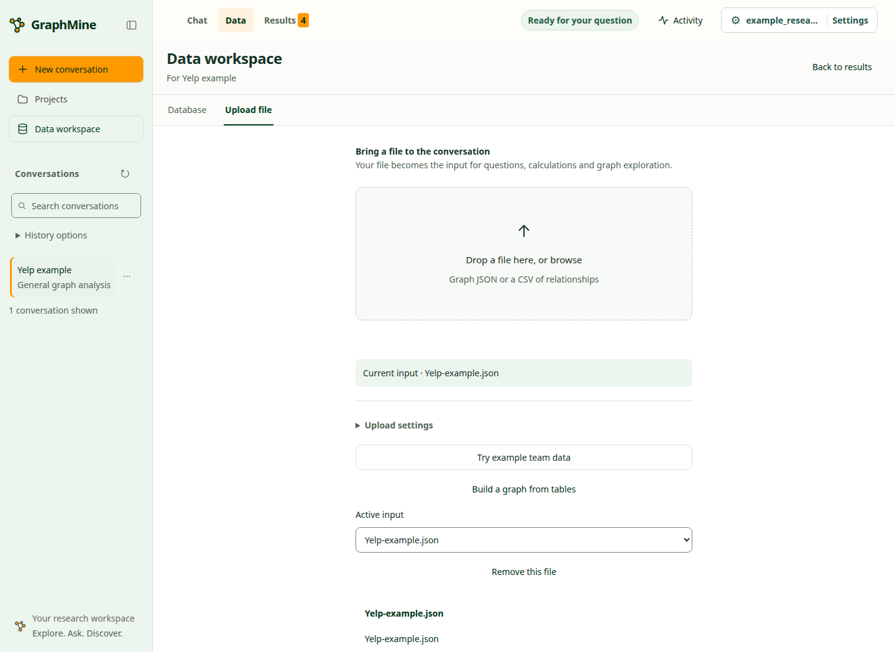

# Bring and prepare data

Create a graph input whose direction, identifiers, weights, and sides match your question.

## Upload a file

Open **Data** or the attachment control. Graph JSON declares vertices and edges explicitly. A relationship CSV needs source and target columns; inspect the import preview before selecting **Import this graph**. Choose whether connections are directed. Text identifiers such as `001` should remain text when leading zeros matter.

An edge list creates vertices from its endpoints. Use canonical graph JSON when isolated vertices or richer record metadata must be declared explicitly. See the [graph format](../library/graph-format.md) for an example.



## Use example datasets

Choose an example offered by your workspace, or **Try example team data** for a small start. Available dataset choices can vary. Selecting an example does not imply that every operation is suitable for it: a Yelp user–business graph, for example, needs explicit two-sided semantics for a biclique calculation.

## Build a graph from tables

Choose **Build a graph from tables**. Select the connection table, **From column**, **To column**, and identifier types. Declare the intended calculation and what a weight column means. Choose how repeated connections should be handled: keep them, reject them, or combine weights using the supported aggregation.

Inspect the preview before saving. Joins, attributes, and time-window settings can enrich the graph, but they must preserve the intended record identities and relationship meaning. A many-to-one join is different from multiplying rows through an unrestricted join.

## Query an available dataset

For a dataset that exposes Cypher, use the query editor, inspect its returned rows or graph elements, and save the selected graph input for analysis. For example:

```cypher
MATCH (a)-[r]->(b)
RETURN a, r, b
LIMIT 100
```

This example selects a bounded set of relationships and endpoints. Its result is not the entire dataset. Use the actual labels and properties shown for your selected dataset. Check the preview and source scope before treating a subsequent calculation as a population-wide result.

## Save and reuse inputs

The saved-dataset controls let you keep reusable inputs and versions. The active-input selector chooses what the next question uses. Removing an uploaded file does not necessarily remove copies already retained with completed analyses or shared project snapshots. [Privacy and deletion](privacy.md) explains those scopes.
