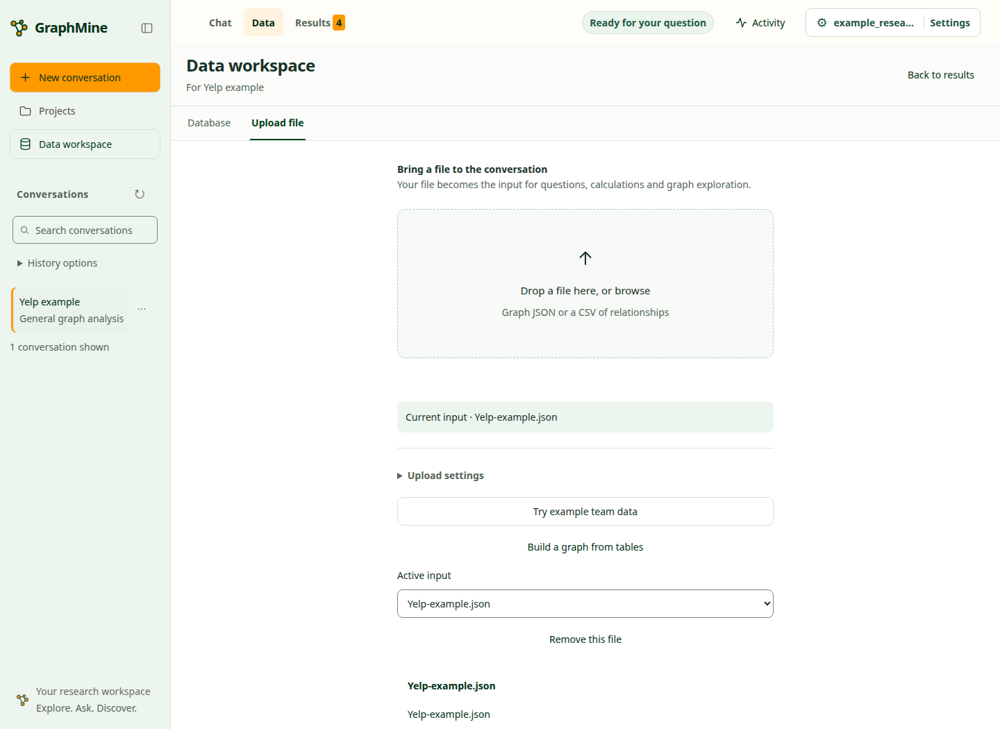

# Get started with the app

Run a first question and learn where to find the input, answer, and evidence.

## Sign in and start a conversation

Ask the person who invited you for access, then [open GraphMine](https://graphmine.autographmine.com/#) and sign in. Choose **New conversation**, select a domain that fits your data, and optionally give the conversation a name. The domain supplies context; it does not change an algorithm's definition.

The sidebar holds saved conversations. **Chat** is where you ask questions, **Data** is where you select and inspect inputs, and **Results** is where you explore completed calculations. **Activity** shows progress and details for the current work.

*The current interface in a test account, using anonymized example data.*

## Try a first question

1. Open **Data** or the attachment button in Chat.
2. Choose an available example dataset. If Yelp is available, use a saved user–business graph with its two sides declared. You can also upload a graph or choose **Try example team data**.
3. Confirm which input is selected. Check the vertex and relationship counts, direction, and record types.
4. Return to **Chat** and choose **Normal** mode.
5. For Yelp, ask: “Find maximal groups of users and businesses where every selected user is connected to every selected business.” This asks for **maximal bicliques**. For the team example, try “How many triangles are in this graph?”
6. Read the proposed **Family**, **Problem**, **Operation**, and quality. Answer a clarification or select **Use this option** when prompted.
7. Wait for the calculation. Read the answer, then open **Results** to inspect the returned items.
8. Open **Download** if you want an image, table, full report, or raw result.

A maximal biclique cannot be extended on either side. It is not necessarily the largest biclique. The [dense-family guide](../problem/families/dense.md) explains related problems that can sound similar.

!!! tip "Start with a concrete objective"
    Name the relationships and what you want to measure. “Find the densest subgraph by edges per vertex” is more precise than “find the best group.”

Next: [asking questions](asking-questions.md), [reading results](results.md), and [bringing data](data.md).
