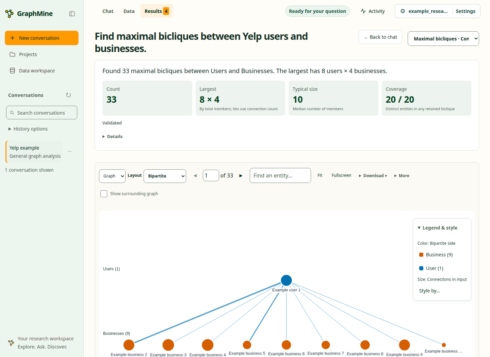

# Read and explore results

Separate the computed answer from its visual preview, then choose the right export.

The answer summarizes the result at the top. Open **Results** to inspect a saved analysis. Its input context identifies the snapshot used, the calculation, and any display or collection limits. Changing your active input does not rewrite an older analysis.

*An anonymized saved example shown through the current result viewer.*

## Graph scope and layout

**Result only** focuses on the returned vertices or relationships. **Show surrounding graph** adds input context and highlights the result within it. Extra neighbors are context, not additional members of the computed answer.

Choose a layout suited to the output. Groups are useful for partitions; a two-sided layout is useful for bicliques; computed coordinates are available when returned by the operation. **Fit graph** brings the visible graph back into view. Use item controls to step through returned groups or witnesses instead of assuming every item is visible at once.

Read the legend before interpreting colors, sizes, and line styles. Selection can link the graph, chart, and table. Search and property filters change what is shown. **Expand neighbors** adds relationships from the saved input; it does not rerun the mining operation or certify a new group.

## Tables, charts, matrices, and galleries

The available views depend on the result type. A matrix preserves row and column identities for pairwise values. A gallery separates returned items into small views. A linked chart can show a distribution or ranking while the table retains the underlying rows. Selecting an item highlights its corresponding records where that view supports selection.

A filtered table, a displayed graph, and a complete result are different scopes. Check the visible counts and truncation messages. An exact total can coexist with a capped list of witnesses.

## Downloads

| Download | Contents |
| --- | --- |
| Image (PNG) | A raster image of the current visualization. |
| Image (SVG) | A scalable vector version of the current visualization. |
| Table with names (CSV) | The selected saved output table, with resolved names where available. |
| Visible entities (CSV) | The entities or items currently represented by the visible view. |
| Full report (ZIP) | A readable report plus retained inputs, plan, results, tables, provenance, and an image when available. |
| Raw result (JSON) | The saved structured result for the analysis revision, including nested values and metadata. |
| Download session archive | The conversation archive available from the conversation's controls. |

CSV is convenient for spreadsheets. JSON preserves typed identifiers and nested structure. A “full” export includes what the calculation retained; it cannot recover witnesses that were never materialized.

## Quality and saved views

**Exact** concerns the calculation's contract. **Heuristic** does not promise a global optimum. **Complete** and **incomplete** describe the relevant computation or collection. A display cap is a separate limitation. Read [guarantees](../problem/guarantees.md) before making an exhaustive or optimality claim.

View settings are saved as you explore. If saving fails, use **Retry saving**. If two tabs disagree, **Reload saved view** uses the stored version; **Keep this view** retains your current choice. Resolve that choice before closing the tab.
