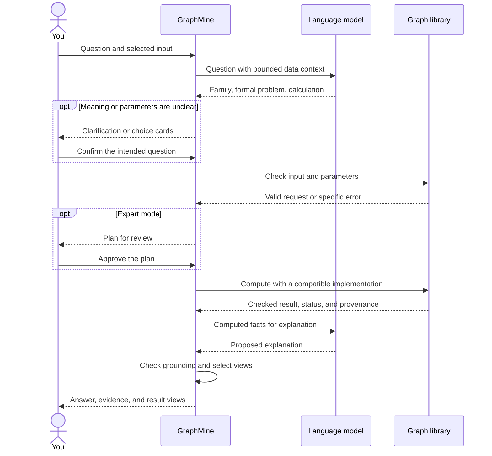

# From a question to an answer

Follow the decisions and checks made for one analysis.

The model proposes an interpretation within the known catalog. It cannot create a new executable algorithm to fill a gap. The runtime checks actual inputs and parameters, including derived inputs in multi-step work. A proposed plan is not proof that an operation can run.

Normal mode proceeds after the necessary user choices. Expert mode exposes the plan for review and approval. Both use the same native contracts and result checks.

When execution fails, the answer is a failure with a reason. When a collection is incomplete, that status travels with it. An explanation must stay within the returned facts; if generated wording cannot pass grounding checks, the application can show a factual fallback.
