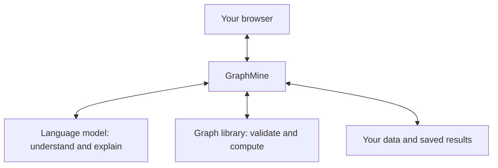

# How GraphMine works

Understand how your question, data, computation, and explanation fit together.

You bring connected records and ask a question. GraphMine identifies a formal problem, checks that an available calculation can answer it, and runs that calculation on the chosen input. It keeps the structured result so you can inspect tables, graphs, parameters, and downloads.

The language model helps interpret intent and explain returned facts. The library owns numerical results. The application connects those parts, asks for missing decisions, and selects views using the result's type and shape.

The same compiled library is available to developers without the web app. Its C++, C, Python, and command-line entry points share operation contracts.

[Follow one question](from-question-to-answer.md) · [Language-model boundaries](language-model.md) · [Result views](results-and-views.md)
