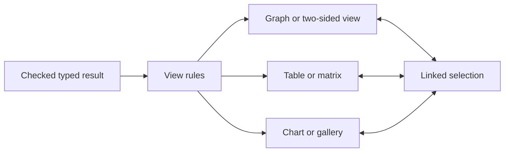

# How results become views

Understand why the same graph can be shown in different ways after different calculations.

GraphMine selects result views from declared output types and the returned structure. A vertex partition can be shown as groups. A biclique has two sides. A path has an order. A matrix has row and column identities. These facts guide layout and controls without asking the language model to invent a visualization.

A view can display a result subset or surrounding context. Selecting a row or item can highlight the corresponding vertices and relationships. The view preserves original record identities so you can connect a computed group back to the input.

Display limits keep a large result readable. They do not redefine a count or prove that an incomplete collection is complete. The result's metadata remains the source of truth. Saved exploration settings preserve a view state, while the underlying result remains the computed artifact.
