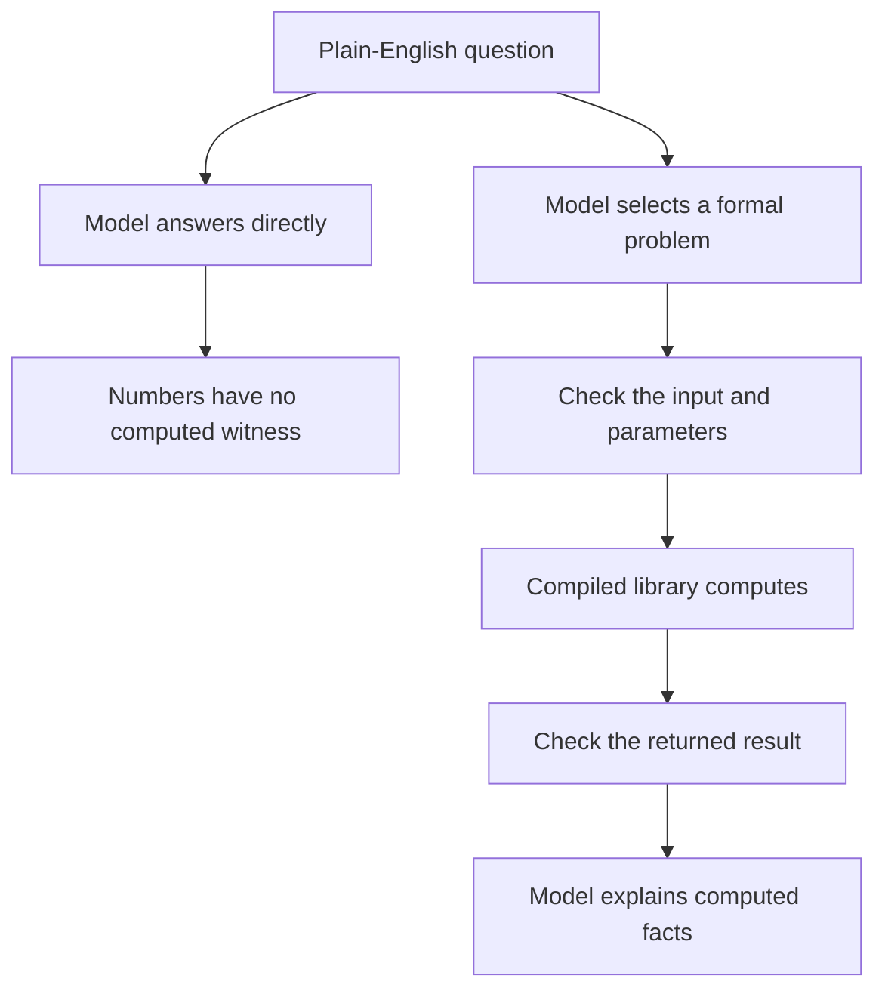

# The problem

Understand why a useful graph answer starts with a precise question, not an algorithm name.

“Find a dense group” has several meanings. A **maximum clique** is the largest group in which every pair is connected. A **densest subgraph** maximizes induced edge value per vertex. A **densest k-subgraph** fixes the number of vertices first. These can return different groups on the same input.

The question also leaves assumptions open. Do relationships have a direction? Are weights costs, capacities, or strengths? Does a two-sided graph distinguish people from businesses? An algorithm can be correct for one interpretation and irrelevant to another.

## Separate interpretation from computation

A language model can help interpret a question. Its generated text is not a calculation or proof. GraphMine therefore separates the choices that need language understanding from the work that needs executable contracts.

GraphMine uses a problem-first taxonomy, constrained operation choices, explicit input checks, and recorded outputs. When the question has several plausible meanings, it asks for a choice. When a calculation cannot satisfy its contract, it reports the limitation instead of replacing it with a plausible number.

This does not remove every error. A user can choose the wrong interpretation, a model can misunderstand intent, and algorithms have input and resource limits. [Guarantees](guarantees.md) explains what each result actually promises.

## Two ways to read the catalog

Start with the [family guides](taxonomy.md#browse-the-families) to learn what the problems mean and how to run their compiled operations. Use the [code reference](../library/code-reference.md) for function signatures, types, source files, and implementation details. A research paper is a third kind of evidence: it describes an algorithm, but does not establish that its code is part of your build.
