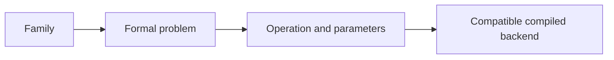

# Families, problems, and operations

Learn the three levels used to turn a question into a callable computation.

| Level | What it tells you | Example |
| --- | --- | --- |
| Family | The kind of question | Cliques & dense subgraphs |
| Formal problem | The mathematical input, objective, output, and guarantee | Maximum clique |
| Operation | A concrete callable calculation and its parameters | `maximum-clique` |
| Backend | A compiled implementation of that operation | A CPU or CUDA implementation |

A family helps narrow the search. A problem makes the intended answer precise. An operation specifies how the runtime accepts inputs and returns results. Several operations can serve one problem, and an operation can have several backends.

## What is in a contract?

A formal contract declares the graph kind and normalization, required parameters, required and optional outputs, solution semantics, validation rules, and edge cases. For example, maximum clique requires mutually adjacent vertices and distinguishes a feasible clique from a proven optimum.

The taxonomy is defined in [`catalog/family.json`](https://github.com/wajidmanzoor/graphMine/blob/main/catalog/family.json) and [`catalog/problems.json`](https://github.com/wajidmanzoor/graphMine/blob/main/catalog/problems.json). Individual problem contracts are linked from the generated family pages. The runtime embeds the same taxonomy; the public catalog is generated from a recorded native build and those contracts.

The record-query family contains workflow utilities. Its utility group is counted separately from the formal research problems.

## Browse the families

- [Look up records](families/records.md) — Which stored records or connections match my request? Look up, filter and summarize stored vertex and edge records, including bounded connection queries and extraction by record selectors. Path queries overlap with paths, and graph extraction overlaps with preparation; choose this family when the goal is retrieving records satisfying a request.
- [Paths & reachability](families/paths.md) — How do I get from A to B, what can reach what, or in what order? Search, optimize or enumerate routes, compute reachability, or order dependencies. Bounded path queries also exist in records; choose this family when the goal is route analysis or dependency order.
- [Connectivity, cuts & trees](families/connectivity.md) — Is it connected, where does it break, or what is the cheapest way to connect it? Find components and biconnected blocks, identify capacity bottlenecks with flow and cuts, or connect vertices and required groups with trees.
- [Cliques & dense subgraphs](families/dense.md) — Which tightly connected groups exist? Clique: every pair connected. Biclique: every cross pair connected. k-core: at least k neighbours each. k-truss: each edge in at least k−2 triangles. Densest: most edges per vertex, or the declared weighted or higher-order clique density. Quasi-clique: a minimum internal-degree fraction. These operations select subgraphs satisfying a structural definition; they do not require a partition of all vertices.
- [Communities & partitions](families/communities.md) — How should vertices be grouped or partitioned? Find communities, balanced partitions or signed-network group structure. Full partitions assign vertices to groups; local and overlapping communities may cover only part of the graph. Unlike dense, the organizing question is group membership or partition structure, rather than selecting a subgraph by a clique, core, truss or density definition.
- [Importance & influence](families/importance.md) — Which vertices matter most, or which seeds spread furthest? Measure vertex centrality, rank vertices globally or relative to chosen seeds, or select seeds for an explicitly defined spreading process.
- [Similarity & comparison](families/similarity.md) — How alike are two vertices or two graphs, or which link is missing? Compare network neighborhoods, score possible missing links, or compare and align graphs through edit distance, common subgraphs or vertex correspondences.
- [Counting motifs](families/motifs.md) — How many small shapes (triangles, butterflies, graphlets, motifs, timed motifs) are there? Count or list the supported shapes, including updates to triangle counts and ordered temporal events. Bipartite and temporal input requirements determine eligibility, not separate families.
- [Pattern matching & mining](families/patterns.md) — Where does a given pattern occur, or which patterns are frequent? Match a supplied pattern or mine frequent subgraphs in one graph or a graph collection, using the operation's declared matching and support semantics.
- [Assignment & selection](families/selection.md) — Pick non-conflicting pairs or items, cover every edge, or colour without conflicts. Match pairs or assign workers to tasks, select independent vertices, cover connections with vertices, or assign colours under the declared conflict rules.
- [Prepare, sample & draw](families/preparation.md) — Build, clean, shrink, sample, extract or draw a graph before analysis. Resolve entities, construct or reduce graphs, sample neighborhoods or walks, and compute layouts. Graph extraction overlaps with records; choose this family when the goal is preparing a graph for subsequent analysis.
- [Spectral & topology](families/spectral.md) — Eigenvectors, smoothing signals over the graph, or shape across thresholds. Compute Laplacian eigenpairs, denoise graph signals, or track topological features through a filtration.
- [Statistics & anomalies](families/statistics.md) — Is this unusual compared with a baseline or a random graph? Detect graph anomalies under an explicit baseline or assess significance against a declared null-model ensemble.
- [Learning & embeddings](families/learning.md) — Learn from features and labels, or learn vectors for vertices or triples. Train vertex, graph or hypergraph predictors, condense training data, infer locations under a declared model, or learn node and knowledge-graph embeddings. Hypergraph inputs are an eligibility requirement, not a separate family.

## From a guide to code

Each family page gives definitions, example questions, operation profiles, command templates, and research references. The [explorer](explorer.md) adds parameter schemas, CPU/GPU filters, and output-port details. The [native code reference](../library/code-reference.md) documents the current C++/CUDA source, rather than treating a paper collection as an installed API.
