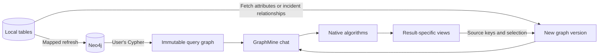

# Database queries and result views

This feature connects a locally installed PostgreSQL database to Neo4j and the
existing GraphMine conversation and native analysis engine. SQLite is also
supported as a local tabular source. Database drivers are an optional agent
dependency; existing upload-based conversations continue to work without them.



## User workflow

1. Choose **Select database & write Cypher** on the home page, or **Database
   queries** in the sidebar. Select a configured source. The schema panel shows
   its graph labels, relationship types and available table attributes.
2. Write Cypher and optional JSON parameters. Choose directed analysis, or an
   undirected projection for algorithms such as density and clique mining.
   **Preview query** saves the exact returned graph. **Run & open chat** reuses
   that snapshot if the query, parameters, database and direction are unchanged.
3. Ask an English question in the existing chat. Normal, Interactive and Expert
   retain their existing validation, approval, execution and model settings.
   Database-backed analyses open the results page after completion.
4. The default graph presents the result witness. **Highlight result in input
   context** shows its place in the actual input of that workflow step. Click a
   result row or choose an item to focus it. Shortest-path results include a
   destination picker. Preview limits apply after resolving the complete saved
   output and input, including graph outputs from previous steps.
5. **Add table attributes** looks up selected entities or all members of the
   focused result by their source keys. Choose a mapped entity/relationship table
   and fields. Fetched attributes appear in entity details and a searchable table;
   node labels and colors can use them. Numeric colors have a range legend and
   categorical colors have value keys. Switching result/context views retains
   the overlay during the current page session.
6. **Add relationships** reads rows incident to the selected vertices from a
   configured relationship table and retrieves their endpoints. It creates a new
   graph version. **Use new graph version in chat** makes that version the next
   analysis input. Successive attribute fetches and expansion retain prior fetched
   attributes. Existing metrics and saved workflow artifacts stay unchanged.

Relationships returned without endpoint nodes are hydrated within the same
Neo4j transaction. Scalar-only Cypher results are inspectable but do not create
an analysis graph. Query `LIMIT` defines the requested snapshot; GraphMine does
not silently truncate that snapshot to satisfy its resource limits.

## Local demo

Use a separate checkout and the [existing build and deployment instructions](../README.md)
for the native GraphMine runtime and model service. The database demo uses separate ports and persistent
volumes; it does not replace the application database or an existing Neo4j
installation. It seeds eight fictional accounts and ten transfers, with a dense
four-account group and a weighted path whose cheapest route differs from its
direct connection.

From the repository root (create `.venv` with `uv venv .venv` if needed):

```bash
uv pip install --python .venv/bin/python -e 'agent[test,databases]'
npm ci --prefix agent/visualization --ignore-scripts
.venv/bin/python deploy/database-workspace/init_demo.py
docker compose --env-file .database-workspace/demo.env \
  -f deploy/database-workspace/compose.yaml up -d
set -a
. .database-workspace/demo.env
set +a
# Once PostgreSQL and Neo4j have started:
.venv/bin/python -m graphmine_agent.database_sync local-transfers
# Use the app's existing model/auth configuration and a separate data directory.
GRAPHMINE_AGENT_DATA_ROOT="$PWD/.database-workspace/agent-data" \
  .venv/bin/graphmine-agent serve --host 127.0.0.1 --port 8011
```

The Compose file pins PostgreSQL 16.15 and Neo4j Community 5.26.32. Generated
credentials and mappings are owner-readable files in the ignored
`.database-workspace/` directory. `init_demo.py` refuses to overwrite them.
Use `--user USERNAME` (repeatable) to restrict a source to particular GraphMine
accounts. The default demo source is available to all authenticated local users.
For another port pair, use `--sql-port`, `--bolt-port` and `--neo4j-http-port`.

The same mappings work with separately installed services. Set the SQL DSN and
Neo4j connection environment references in `sources.json`, seed only a disposable
demo database with `seed.sql`, and run the sync command. The implementation has
also been exercised using PostgreSQL 16 and the Neo4j Linux distribution without
Docker. [Neo4j downloads](https://neo4j.com/deployment-center/) and
[PostgreSQL installation](https://www.postgresql.org/download/linux/ubuntu/).

Example Cypher:

```cypher
MATCH p = (a:Account)-[:TRANSFER]->(b:Account)
RETURN p
```

Choose undirected analysis and ask “Find the densest subgraph.” Choose directed
analysis for “Find the shortest paths from Ada,” then select Chen as the
destination. `risk_score`, `country` and `segment` are initially kept in SQL;
fetch them from the result view. The source database can contain additional
unmapped columns; they are not available to the application until explicitly
added to the mapping.

Stop the demo containers with the same Compose command ending in `stop`. Keep
the volumes to retain the demo data. This setup does not install or replace a
language model; English planning uses the application's configured model service.

## Source mapping and data integrity

`GRAPHMINE_DATABASE_SOURCES_FILE` points to a JSON array of sources. The file must
belong to the application user with mode `0600`. Each source defines:

- A stable source ID, display name, allowed GraphMine usernames and mapping revision.
- `sql_type` (`postgres` or `sqlite`), a DSN environment-variable name or SQLite
  path, and a fixed Neo4j URI/database with credential environment references.
- Entity tables with primary-key columns, a Neo4j label, exposed `attributes`,
  optional `graph_attributes` to import initially, and an optional display field.
- Relationship tables with their own keys, source/target entity mappings and
  foreign-key columns, a relationship type and optional weight/timestamp columns.

Composite and typed keys become stable application IDs. Imported Neo4j elements
carry `gm_id`, source mapping, encoded key, import time and mapping fingerprint.
SQL lookup uses these keys, never Neo4j's internal IDs. Neo4j element IDs are used
only to hydrate endpoints inside a live query transaction or identify unmapped
elements in that snapshot. Unmapped elements can be analyzed but cannot be
enriched. A changed mapping requires refresh and a new query snapshot. Bump the
source revision when changing the target behind a DSN environment variable.
[Neo4j identifier semantics](https://neo4j.com/docs/cypher-manual/current/functions/scalar/#functions-elementid).

SQL reads use validated mapping identifiers, parameterized keys and read-only,
repeatable-read transactions. They fetch bounded rows using server cursors for
PostgreSQL. The sample SQL account has SELECT privileges only. A mapped graph
refresh is one Neo4j transaction and replaces only that source's imported
`GraphMineEntity` nodes and attached relationships. The importer creates a
uniqueness constraint on `GraphMineEntity.gm_id`; its writer credentials need
permission to create that constraint. Relationship expansion reads SQL into a
new GraphMine version; Neo4j changes only on an explicit mapped refresh.

The Cypher editor allows a single read query and checks its `EXPLAIN` query type.
Write clauses, procedure calls, external loading and database switching are
outside this editor's contract. Read routing is not treated as a security
boundary. Use a dedicated read account where the Neo4j edition supports it,
and optional separate writer credentials for refresh. Source permissions grant
query access to the configured Neo4j database: labels are not a tenant boundary.
Use separately authorized databases/instances for separately authorized data.
[Driver transaction behavior](https://neo4j.com/docs/python-manual/current/transactions/).

Queries and source lookups have transaction/statement deadlines, row/byte limits
and bounded concurrent admission. Files, workflows, query snapshots and source
permissions are checked at each handoff. Enrichment records its timestamp,
selection, parent file, missing rows and mapping. Adding current source data
creates a mixed-time view by design; it does not refresh old algorithm scores.
Its persisted graph version is the input for a new calculation. Labels/colors
are page-session presentation state; fetched graph versions persist in the
dataset library and conversation files.

## Backend interfaces

| Endpoint | Behavior |
| --- | --- |
| `GET /api/database-sources` | Sources visible to the current user, without credentials |
| `GET /api/database-sources/{id}` | Exposed graph/table mapping |
| `POST /api/database-sources/{id}/sync` | Refresh the mapped Neo4j projection |
| `POST /api/database-sources/{id}/queries` | `{statement, parameters, directed}` → saved graph version and bounded preview |
| `POST /api/database-query-snapshots/{version}/chat` | New conversation with that exact snapshot attached |
| `GET /api/workflows/{id}/steps/{step}/ports/{port}/view` | Full-result focus or `context=true`, optional `index` |
| `GET /api/files/{id}/source-schema` | Current source mapping for an owned database input |
| `POST /api/files/{id}/enrichments` | `{mapping, fields, kind, ids?, selection?}` → new version and attribute updates |
| `POST /api/files/{id}/expansions` | `{mapping, ids?, selection?}` → new version and added vertex/edge counts |

`selection` contains workflow ID, revision, step, port and optional item index.
The server resolves membership from saved evidence. Browser-provided IDs must
belong to that selection. Enriched descendants can be used as the base while
preserving the selected result's topology. Synthetic coarsened/condensed nodes,
pattern-local IDs and cross-graph correspondences need an explicit occurrence
or correspondence mapping before source enrichment; the UI does not guess it.

## Presentation contracts

`result_views.py` declares an intentional presentation contract for all 82
current native operations and exposes it in capabilities. Existing graph,
table, bars, embedding and temporal controls are reused. Additional building
blocks cover focused witnesses, path sequences, pair matrices, histograms,
spectra, persistence intervals, location coordinates and source attributes.

| Algorithms | Primary presentation and useful details |
| --- | --- |
| Single-source shortest paths, widest paths, BFS | Predecessor forest, destination-specific path, ordered vertices, distance/capacity table; no chord edges |
| Query paths, critical paths, bounded paths/cycles, temporal paths, walks | One recorded sequence; exact edge IDs where retained, edge/vertex order, weight or timing; walks without edge IDs label their endpoint witnesses |
| Densest subgraph, densest-k, seeded local community, k-core | Returned members and induced internal edges; saved density/objective and membership; core-score table where no thresholded set was requested |
| Cliques, quasi-cliques, overlapping communities, connected/biconnected components, triangles and dynamic triangles | One group, group sizes, members, shared membership; count-only outputs have no fabricated occurrence |
| Community detection, balanced partitioning, signed balance, hypergraph partitioning | Partition overview and membership; selected partition focus when a graph input is available; hypergraph membership remains tabular |
| Maximal bicliques | Separate left/right columns and membership |
| Spanning forests, Steiner trees, matchings, k-truss, sampling, edge filters | Returned edges only, endpoint/weight table, isolated returned tree vertices |
| Lookup, neighbors, common neighbors, independent sets, vertex cover, influence seeds | Selected vertices; surrounding connections available through input context; scores/spread remain saved facts |
| PageRank, personalized PageRank, degree, betweenness, aggregate scores, butterfly participation | Score-scaled network and ranked bars with the score table |
| Anomalies, denoising | Ranked scores or signal-component bars, explanation/vector table, selected entity witness |
| Extracted/induced/common subgraphs, coarsening, condensation, sparsification, kNN | Actual returned graph; generated namespaces are not treated as original source IDs |
| Frequent patterns, isomorphism, motifs, graphlets, temporal motifs | One pattern or recorded occurrence; support/count table; source-member mapping or recorded event edges where available |
| Maximum flow/minimum cut | Positive flow assignments with direction control, capacities and separate cut facts |
| Many-source distances, reachability, SimRank, link prediction, entity resolution | Pair table and bounded matrix; selecting a pair inspects endpoints, not an invented path or predicted edge |
| Graph edit distance, network alignment | Correspondence/edit table with separate input namespaces |
| Node and knowledge-graph embeddings | Selectable coordinate dimensions, vector table, projection disclosure |
| Node/graph/hypergraph learning | Prediction and metric tables; predictions are distinct from SQL attributes |
| Geolocation, force layout | Location-coordinate plot or computed layout, exact coordinates and confidence table |
| Topological sort, coloring | Recorded order or color classes with the table |
| Persistent homology, null-model significance, eigenpairs | Persistence barcode, sample histogram or eigenvalue spectrum with exact output tables |
| Biclique count | Scalar metric; no enumerated instances implied |

Incomplete and count-only results remain visibly labelled. Graph previews show
at most 500 vertices and 2,000 edges; table/chart bounds are also disclosed.
Many-source distances do not contain path predecessors, so a distance matrix is
used. Predecessor-only outputs identify vertex pairs rather than parallel-edge
IDs; their path view labels its minimum-weight (or maximum-capacity for widest
paths) representative edges. Source details are loaded only for actual
source-backed witnesses.

## Verification

```bash
.venv/bin/python -m pytest agent/tests/test_database_workspace.py \
  agent/tests/test_result_views.py -q

# Only against the disposable seeded demo; the integration test refreshes it.
GRAPHMINE_TEST_DATABASE_INTEGRATION=1 .venv/bin/python -m pytest \
  agent/tests/test_database_integration.py \
  agent/browser_tests/test_database_roundtrip.py -q
```

The live checks use real PostgreSQL, Neo4j, native CPU calculations, the API and
Firefox. `GRAPHMINE_TEST_RUNTIME_ROOT` may reference a compatible existing native
checkout; application code still comes from the candidate branch. The English
browser test replays authored planner/answer responses through the real planning
APIs; it verifies the interaction and data flow, not language-model accuracy.
Native shortest-path and density results are computed rather than mocked.
