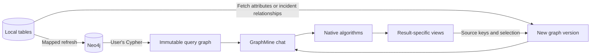

# Database queries and result views

This feature connects Neo4j to the existing GraphMine conversation and native
analysis engine. PostgreSQL or server-configured SQLite tables can optionally
supply mapped attributes and relationships. The same source picker also offers
standalone SQLite uploads and REST imports. Database drivers are an optional
agent dependency; upload-based conversations continue to work without them.



## User workflow

1. Open **Data workspace** from the sidebar or home page, or **Data** from the
   conversation toolbar.
   The **Database** tab selects an available query or import connection. For
   Neo4j it checks the graph service and any configured PostgreSQL service.
   Each verified benchmark has its own Neo4j connection and dataset.
   Ordinary connections expose their default Neo4j graph.
   Selecting a dataset displays its published schema and a starting Cypher query.
   **Add connection** offers Neo4j with optional PostgreSQL, a private SQLite
   upload, or a REST export. SQLite and REST use **Preview source** and an
   **Import** step instead of the Cypher editor. The **Upload file** tab accepts
   graph JSON or relationship CSV.
2. Write Cypher and optional JSON parameters. **Graph from** selects returned
   graph elements or **Source / target columns** for new relationships derived
   from query rows. Choose directed analysis, or an
   undirected projection for algorithms such as density and clique mining.
   **Preview query** retains the exact returned graph temporarily for 24 hours.
   Identical preview content is stored once per owner; each query keeps its own
   timestamp and provenance. **Save graph to datasets** keeps it in the library;
   **Discard preview** releases an unused preview. **Use graph in chat** keeps and reuses
   that snapshot if the query, parameters, database and direction are unchanged,
   and updates the current conversation's input. After a successful preview,
   choose a domain and **Start conversation** to create a chat. The selected
   domain is validated by the server. Reopening Data workspace restores the current
   query. Drafts autosave in this browser and survive reloads, scoped by account,
   API endpoint, conversation/input, connection and dataset. **Discard draft**
   restores the starting query. If browser storage is unavailable, the editor
   reports that the draft is retained only for the current tab.
3. Ask an English question in the existing chat. Normal, Interactive and Expert
   retain their existing validation, approval, execution and model settings.
   Database-backed analyses open the results page after completion.
4. The default graph presents the result witness. **Highlight result in input
   context** shows its place in the actual input of that workflow step. Click a
   result row or choose an item to focus it. Shortest-path results include a
   destination picker. Preview limits apply after resolving the complete saved
   output and input, including graph outputs from previous steps.
   **About this result** shows the saved input version and primary graph counts,
   original query/parameters and source scope, recorded method/quality and
   output completeness, and current display limits. These refer to the selected
   workflow revision even after the conversation's active graph changes.
5. With SQL mappings configured, **Add table attributes** looks up selected entities or all members of the
   focused result by their source keys. Choose a mapped entity/relationship table
   and fields. Fetched attributes appear in entity details and a searchable table;
   node labels and colors can use them. Numeric colors have a range legend and
   categorical colors have value keys. Switching result/context views retains
   the overlay, and reopening the conversation restores its saved attributes.
6. With SQL mappings configured, **Add relationships** reads rows incident to the selected vertices from a
   configured relationship table and retrieves their endpoints. It creates a new
   graph version. **Use new graph version in chat** makes that version the next
   analysis input. Successive attribute fetches and expansion retain prior fetched
   attributes. Existing metrics and saved workflow artifacts stay unchanged.

Relationships returned without endpoint nodes are hydrated within the same
Neo4j transaction. Scalar-only Cypher results become complete typed table
snapshots that can be inspected, exported, saved, and mapped into an analysis
graph. Query `LIMIT` defines the requested snapshot; GraphMine does
not silently truncate that snapshot to satisfy its resource limits.

Data workspace contains **Database** and **Upload file**. File selection,
CSV projection, saved inputs and project inputs are in Upload file.
It is a page with its own routes: `#data`, `#data/query`, `#data/preview` and
`#data/files`, or `#workspace/{session}/data/{step}` within a conversation.
The wide layout presents connection/schema, query and preview in separate
scrollable panes. Connection health and management remain accessible without
displacing the schema. At widths up to 1100 pixels, **Connection**, **Query** and
**Preview** steps show one pane at a time, with keyboard navigation between steps.
The editor, parameters and preview stay mounted when changing steps; doing so
does not execute the query again. A successful query opens Preview, and the
conversation action stays visible below it. Errors return to Query.

The page's Back control returns to the originating conversation or result;
browser Back/Forward and reload also work. A reload restores the scoped draft
without submitting it. Background query jobs can be resumed from their history.
Connection discovery does not hold navigation or file uploads. A response that
finishes after leaving the workspace cannot replace the new page; uploads remain
attached to the conversation that accepted them.

The separate **Tools** drawer contains calculation, compute and workflow tools.
On desktop, Tools and Activity dock to the right and resize the conversation.
Messages and the composer use the available width beside the navigation.
On mobile, Tools and Activity remain dismissible overlays; Data uses the full
page with its step controls and actions outside the scrolling pane.

Each explicit **Preview query** executes again. **Refresh datasets** retains
the current query and parameters. Preview feedback distinguishes dataset totals,
query totals and the visible graph sample, and includes elapsed time.

Schema 9 adds private conversation exploration preferences and quota accounting,
following schema 8's durable database jobs and their storage accounting,
schema 7's reusable typed query tables, schema 6's private saved queries and
bounded history, and schema 5's expiring previews. Existing datasets keep
their content and IDs. Older application versions refuse this schema; rollback
requires compatible code or a verified backup made before migration. Temporary
previews count toward account storage, including per-query provenance. Cleanup
runs at startup, hourly, and before storing another preview. Saved datasets and
conversation inputs do not expire with previews.

### Background queries and synchronization

**Preview query** and **Refresh graph from tables** submit durable jobs. The
status panel shows the current phase and counts when available; it does not
invent a percentage while the database is still discovering rows. Closing the
workspace or reloading the page leaves server work running. Reopen the same
connection's **Database jobs** panel and choose **Follow job** or **View result**.
Viewing a completed job reads its immutable snapshot without executing Cypher.
Preview expiry still applies; save or use the snapshot to retain it.

Filter the history to **Graph synchronization** and choose **View changes** to
inspect a completed refresh. The summary separates added, updated, removed and
unchanged nodes and relationships, identifies relationship endpoint/type changes
within the updated count, and reports mapping revisions. Its synchronization
record contains the completion time and mapped-content SHA-256. A successful
no-change refresh shows zero writes; a failed refresh retains its error instead
of showing a successful empty summary. Saved analyses retain their original
inputs; preview a new query to use the refreshed source graph.

**Cancel job** immediately stops queued work and requests cooperative cancellation
of running work. Running reads check cancellation between rows, and graph writes
check it between batches. A blocked driver call must return or reach the source's
configured timeout before rollback completes; the panel says **Cancellation
requested** until that happens. Cancellation closes atomically before committing
graph changes or publishing a snapshot, and the panel explains when it is too
late. Uncommitted graph writes roll back on cancellation.

Queued work resumes after an ordinary server restart with a fresh account check
and the original connection/mapping fingerprint. Work interrupted while running
is never replayed automatically. **Retry job** explicitly creates a new job;
changed connection settings require reviewing and submitting new work instead.
An interrupted synchronization may have committed, so its details direct users
to inspect the source graph before retrying. A staged backup restore stops all
pending database jobs and requires explicit retry, even when they were queued.

Jobs, requests and results are private to their owner and included in online
backups. The queue admits at most eight pending jobs per account and
`GRAPHMINE_MAX_PENDING_JOBS` across the database queue (default 64). Workers share
the bounded upload/read slots, with at most four workers, and serialize queued
work for each source within the application's metadata database. Each pending job reserves 768 KiB for its bounded metadata;
finished records use their actual bytes, with the latest 200 retained per owner.
Query snapshots retain complete data; graph row samples in the job record have
a separate 256 KiB limit, disclosed when reached.

API clients request an immediate response on the query/sync endpoints with
`Prefer: respond-async`. They receive HTTP 202, `{job: ...}` and a `Location`
header. Supplying an `Idempotency-Key` returns the same retained job for identical
requests; reusing the key for different work returns 409. Synchronization always
uses the durable queue. Without this preference, its endpoint waits for the job
and returns HTTP 200 with the existing totals, change summary and `job_id`.
Disconnecting the waiting client does not cancel the job. Failures retain their
HTTP status and include `job_id` in the error details. Synchronous queries keep
their existing response contract. Polling reconnects with backoff after transient
errors; it never retries a submission implicitly.

### Guided graph builder and query editor

**Build a graph with guided choices** uses the selected dataset's declared
entity and relationship mappings. Select node types, relationship direction,
filters, row limits and analysis direction, then choose **Generate Cypher**.
The generated statement and parameters are inspectable. **Use generated query**
explicitly replaces the current editor contents; generation does not execute
anything. For an unmapped Neo4j graph, including an isolated benchmark, the builder discovers label,
relationship and property names from read-only samples of at most 500 nodes and
500 relationships, also bounded by the connection's row and byte limits.
Discovery uses no administrative procedures. The UI states that this sample
may omit graph structure; the manual Cypher editor remains available. Discovery
failure does not disable manual queries. Mapped SQL-only attributes are excluded
from graph filters.

The builder scopes mapped elements to their source and mapping identifiers.
Benchmark queries use the selected instance and its original published labels. Filter values are parameters, never query
fragments. **Edge weight property** overrides the analysis weight while keeping
original relationship identity and SQL lineage. Every returned relationship must
contain a finite numeric value for the chosen property. Source/target projection
continues to use its returned `weight` column.

**Saved queries & history** stores private queries on the server independently
of browser drafts and preview expiration. Queries retain the statement,
parameters, direction, projection and weight selection. Loading never executes
a query. Updates and deletion check revisions. Storage includes query documents;
each account can keep 250 saved queries and its latest 200 execution records.
List responses are paged summaries; full parameters load only on request.
History preserves success/failure and snapshot references, not result payloads.
A history-storage failure is reported without losing a successful query result.
Online backups include saved queries and history in the metadata database.

The home page's **Saved queries** cards open `#data/query/{query_id}`. The link
selects its saved connection and dataset and highlights the query in the library,
including queries outside the first library page. Existing browser drafts remain
in the editor until **Load into editor** is selected. Loading never executes the
query. On mobile, the shortcut survives connection/query/preview navigation and
reloads until it is loaded or a different source is selected. Missing connections,
datasets or queries show an inline error and retry action. A query moved to a
different connection or dataset cannot be loaded into the old context.

The parameter form detects `$parameters` outside comments and string literals,
supports typed values and exact large integers, and preserves extra JSON keys.
**Format query** preserves strings, quoted identifiers and comments.
**Schema suggestions** (Ctrl+Space) completes labels after `:`, properties after
`.`, parameters after `$`, and query keywords elsewhere. Suggestions support
keyboard selection. Cypher errors appear beside the editor; **Go to error**
uses the server's position when available, including Unicode offsets.

API additions: `GET/POST /database-sources/{id}/graph-builder`,
`GET/POST /query-library`, and `GET/PUT/DELETE /query-library/{id}` (all under
`/api`). Updating a saved query supplies `expected_revision`; deletion supplies
the `revision` query parameter. Query execution accepts optional `weight_property`
and returns `history_id`/`history_warning` alongside the existing preview fields.

### Complete scalar query tables

Queries returning only scalar, list or map values retain every returned row in
an immutable `graphmine.table.v1` artifact, including column names for an empty
result. Values preserve JSON types and exact integers. Queries returning graph
elements retain their graph snapshot and existing row sample instead. Neither
path silently truncates a query to fit the configured row or byte limits.

The table viewer pages through the complete snapshot and sorts across all rows,
with nulls last. **Download CSV** includes all rows in the current sort order,
quotes cells, and escapes spreadsheet formulas; **Download JSON** preserves the
original typed artifact and query order. Paging, sorting and downloads do not
rerun Cypher. Temporary tables follow the same owner checks, 24-hour expiry,
deduplication, storage accounting, save/discard actions and backup rules as graph
previews. Saved tables are available under **Datasets → View complete table**.

The first table read verifies the stored bytes and creates a private SQLite row
index. Later pages and sorts decode only the selected rows. Numeric sort ranks
preserve exact large integers, nulls remain last, and equal values retain query
order in both directions. Database triggers rotate an index token when source
content changes, so a warm index cannot hide a corrupt or replaced blob. Every
request still checks ownership and preview expiry. Promotion keeps the snapshot
ID; discard, expiry and dataset deletion remove the table's derived index.
These indexes can be rebuilt from the immutable source; exports still use the
original complete artifact. Export memory limits are tracked in roadmap step 20.

**Use table in analysis** attaches the original typed table to a conversation
and opens the column mapping form. Review source/target columns, string or
integer ID types, direction and weights before projecting a graph. Attaching a
table preserves any active graph and result. Table-only conversations offer
**Build a graph from tables**. This reader currently uses CPU projection; the
original query, parameters, source and content hash remain in graph provenance.
For the native projection input, null and empty string are both missing cells,
booleans use `true`/`false`, and nested values use JSON text; the saved typed
artifact remains unchanged.

`GET /api/database-query-snapshots/{id}/table` accepts `offset`, `limit` (up to
500), `sort` (column name) and `direction`. The same path ending in `/csv` or
`/json` downloads the snapshot. These routes accept owned temporary or saved
table IDs. The query response identifies scalar snapshots in `table`; graph
snapshots continue to use `dataset`.

### Derived graphs from query rows

Choose **Graph from → Source / target columns** to build a graph directly from
a read query. Return actual Neo4j nodes under the aliases `source` and `target`;
each row becomes one edge in the saved GraphMine graph. An optional numeric
`weight` column sets its analysis weight, and an optional nonempty string `type`
column names the edge type (default `DERIVED`). Other scalar, list or map columns
become edge attributes. Endpoints must be nodes rather than IDs or property maps,
so their dataset scope and SQL source mappings remain verifiable.

For MovieLens 32M, the **Example: users who rated the same movies** button fills
in this query, the parameters, the projection mode and undirected analysis:

```cypher
MATCH (u:User)
WITH u ORDER BY u.userId LIMIT $userLimit
MATCH (u)-[:RATED]->(m:Movie)
WITH m, collect(DISTINCT u) AS users
UNWIND users AS a
UNWIND users AS b
WITH a, b WHERE a.userId < b.userId
RETURN a AS source, b AS target,
       count(*) AS weight, 'SHARED_MOVIE' AS type
ORDER BY source.userId, target.userId
```

Parameters: `{"userLimit": 100}`. This is a sample of the first 100 users by ID.
The query counts distinct shared movies per pair and excludes self-pairs and
reverse duplicates. Increasing the user limit can grow the number of pairs
quadratically. GraphMine enforces its normal row and graph size limits.

The derived edges exist only in the saved analysis graph; the source database is
read without creating relationships. Isolated benchmark snapshots have no SQL
lineage or enrichment. Mapped connections such as Transfers retain their SQL
features; derived edges have no SQL row mapping. Duplicate endpoint rows produce parallel
edges, so aggregate in Cypher when one edge per pair is wanted. Preview, saved
inputs, chat and subsequent analysis use the same graph; reopening the source
picker restores its projection mode.

Table-only results display their returned row count and open the row preview
even when there are no graph nodes. An empty query result is reported separately.

## Benchmark datasets and schemas

Development uses one Neo4j 5.26 Community instance per benchmark, with the
publisher's labels, properties and relationships. Each verified dataset is a
separate connection named after the dataset (`benchmark-<id>` in the API).
Selecting it shows its published schema diagrams, a starting query and a link
to the PropGBench Neo4j workload. Queries run on that instance. There is no
shared-store dataset-label filter and no SQL catalog dependency.

The app lists only entries in `deploy/neo4j-datasets/registry.json` whose
instance has `status=ready`, a passed verification report, matching load hashes,
and the recorded report checksum. A prepared or loaded dataset is unavailable
until verification passes. Source fingerprints include the dataset identity,
load time and script hashes; each snapshot preserves those values and the
workload URL. Neo4j element IDs are namespaced by dataset. Different users'
queries and snapshots remain private and use their selected connections.

Benchmark connections expose no SQL mappings or writer credentials. **Add table
attributes** and **Add relationships** are hidden for their snapshots; the API
also rejects those operations. The Transfers demo retains mapped SQL enrichment,
and expansion. Ordinary Neo4j connections expose their default
graph even when an optional SQL service is unavailable.

The deployed interface has one **Dataset** selector containing Transfers demo,
Yelp, MovieLens 32M, MovieLens Tag Genome and LDBC SNB SF100 BI. Selecting an
entry scopes every Cypher query to its independent instance. The query pane
names that dataset; switching clears the old preview and restores that dataset's
own draft. Connection administration and synchronization controls are hidden.
The API applies `GRAPHMINE_DATABASE_DATASET_ALLOWLIST` too, so hidden legacy,
managed, paused and deferred sources cannot be queried through a direct request.
The benchmark schema catalog exposes only the selected verified datasets and
their Neo4j diagrams and loading/query references. Other platforms are omitted
from the interface and their reference downloads return 404.
An empty allowlist retains the general connection workspace for other installs.

Transfers demo now has its own instance at `bolt://127.0.0.1:17700`. Exactly
8 Account/GraphMineEntity nodes and 10 TRANSFER relationships were copied from
the legacy shared store, with all labels and properties compared after copying.
The old store was not modified. This makes even `MATCH (n) RETURN count(n)`
return only the demo's eight nodes. Its copy, receipt and provisioning script
are in `neo4j-instances/transfers-demo/`; SQL enrichment still reads the existing
PostgreSQL tables using the read-only `graphmine_reader` role.
After the exact copy, only its `gm_mapping_hash` metadata was updated to match
the new connection URI; `mapping-migration.json` records that change and the
comparison of all remaining properties, labels and stable IDs.

The Cypher validator accepts identifiers such as `start` and `stop` in patterns,
properties and aliases while rejecting administrative and writing clauses.
`CALL`, including GDS calls, remains disabled in the app. EXPLAIN must classify
each statement as read-only before execution; reads use READ_ACCESS and rollback.
The existing app limits remain 30 seconds, 100,000 rows and 64 MiB per registry
connection. Administrative verification separately consumes every result from four
representative published queries without changing their text. The user approved
this scope after long Yelp traversals. Remaining queries are explicitly untested;
`--all-queries` is available for a separate exhaustive run.

### Instances and files

All ports bind to loopback; no database firewall ports or public routes are
opened. Each instance uses a systemd user service named
`graphmine-neo4j-<dataset>.service`. These are the configured memory budgets;
actual memory and disk measurements are saved in each `verify_report.json`.

| Dataset | Bolt / HTTP | Heap / page cache | Service memory cap |
| --- | --- | --- | --- |
| Transfers demo | 17700 / 17400 | 1 / 1 GiB | 3 GiB |
| Yelp | 17701 / 17401 | 4 / 12 GiB | 18 GiB |
| MovieLens 32M | 17702 / 17402 | 4 / 8 GiB | 14 GiB |
| MovieLens Tag Genome | 17703 / 17403 | 4 / 8 GiB | 14 GiB |
| Stack Overflow (deferred) | 17704 / 17404 reserved | 4 / 40 GiB planned | 46 GiB planned |
| OnTime (paused; service disabled) | 17705 / 17405 reserved | 16 / 12 GiB configured | 30 GiB configured |
| LDBC SNB SF100 | 17706 / 17406 | 4 / 56 GiB | 62 GiB |

The four benchmark service caps total 108 GiB; the isolated demo adds 3 GiB on
this 251 GiB host. The old shared Neo4j and PostgreSQL services remain intact.
LDBC completed loading and verification. The user paused OnTime after six
monthly flight files completed; its service is stopped and disabled, and its
partial seventh file and prior receipts are preserved. It is absent from the
registry and user interface. Resuming requires review of the partial store;
the loader must not be blindly rerun against it. Each dataset still needs its
own complete loading, count, index and representative-query checks before
publication. OnTime started with a 4 GiB heap; its
first flight import exhausted that heap. The failed new store was preserved
and the loader retried against a fresh empty store with the larger budget above,
without changing the published Cypher.

Measured usage for the four verified instances on 2026-11-16 at 02:51:39 UTC:

| Dataset | Graph store (GiB) | Transaction logs (GiB) | Source cache (GiB) | Service memory, current / peak (GiB) |
| --- | ---: | ---: | ---: | ---: |
| Yelp | 9.76 | 2.19 | 8.11 | 15.31 / 18.00 |
| MovieLens 32M | 2.47 | 2.04 | <0.01 | 7.78 / 14.00 |
| MovieLens Tag Genome | 6.42 | 2.12 | 3.71 | 11.72 / 14.00 |
| LDBC SNB SF100 | 190.39 | <0.01 | 114.72 | 60.05 / 62.00 |

These are observations, not fixed reservations. Service memory includes its
accounted file cache. Disk columns cover the named instance subdirectories;
the original raw datasets and shared binaries are separate. The exact byte
counts are in `neo4j-instances/<dataset>/resource-usage.json`, alongside the
original verification report. OnTime remains paused without a passed
verification report; its stop receipt is `ontime/user-stop-request.json`.

The local data root is `/data/labdata/wajid/graphmine_data`:

| Directory | Contents |
| --- | --- |
| `datasets/<dataset>/raw` | Original downloads and verification receipts |
| `datasets/<dataset>/schemas` | Published diagrams, source pages and snippets |
| `neo4j-instances/<dataset>/conf` | Instance-specific Neo4j and APOC configuration |
| `neo4j-instances/<dataset>/data` | New graph and system stores |
| `neo4j-instances/<dataset>/transactions` | Transaction logs |
| `neo4j-instances/<dataset>/import` | Exact published import paths |
| `neo4j-instances/<dataset>/source-cache` | Verified joined or derived import files |
| `neo4j-instances/<dataset>/logs` | Database logs |
| `neo4j-instances/<dataset>/status.json` | Loading state, counts, load time and hashes |
| `neo4j-instances/<dataset>/verify_report.json` | Query results, counts, indexes and resource measurements |
| `databases/neo4j`, `databases/postgresql`, `imports` | Preserved old stores and preparation artifacts |

Passwords are stored only in the owner's mode-600
`.database-workspace/demo.env`, never in the registry, source code or provenance.
The app reads the required password reference from that file when connecting.
Configure these paths in the development environment:

```bash
GRAPHMINE_NEO4J_DATASETS_REGISTRY=/home/wajid/projects/graphDatabaseAgent/graphMine-database-cypher/deploy/neo4j-datasets/registry.json
GRAPHMINE_NEO4J_INSTANCES_ROOT=/data/labdata/wajid/graphmine_data/neo4j-instances
GRAPHMINE_NEO4J_DATASETS_PASSWORD_FILE=/home/wajid/projects/graphDatabaseAgent/graphMine-database-cypher/.database-workspace/demo.env
GRAPHMINE_BENCHMARK_DATASETS_ROOT=/data/labdata/wajid/graphmine_data/datasets
```

Leaving the registry setting absent disables benchmark discovery. Production
and testing retain their separate environment settings until deliberate rollout.

### Loading and verification

The source copies, audit, instance creator, loader and verifier live in
[`deploy/neo4j-datasets/`](../deploy/neo4j-datasets/README.md). Each dataset's
`SOURCE.md` records its workload URL, copy date, paths and compatibility notes.
Only file paths are substituted in the published Cypher. No extra labels,
properties or relationships are added.

1. Audit source copies with `source_pages.py audit all`.
2. Prepare exact import paths with `prepare_import_dir.py <dataset>` using the
   import virtual environment. It validates original receipts and hashes and
   reuses `legacy/benchmark_import.py::Builder.source()` for byte-split files.
   Links resolve to hard-linked files inside APOC's import boundary without
   duplicating or modifying the originals.
3. Run `create_instance.py <dataset>` using the app virtual environment. It
   refuses existing stores, checks loopback ports and empty databases, and checks
   APOC and the import directory. Matching APOC 5.26.32 is used because 5.26.0
   failed against the installed Neo4j libraries; the evidence is in `SOURCE.md`.
4. In tmux, run `load_dataset.py <dataset>`. It refuses non-empty databases,
   executes each published statement and fails on any APOC batch error. It waits
   for indexes and records the load without publishing the dataset.
5. After loading succeeds, run `verify_dataset.py <dataset>` in tmux. It checks
   label/type counts and indexes, executes four representative published queries,
   records other queries as untested or excluded, and checks that graph counts
   are unchanged. Selected queries have a five-minute timeout by default.
   A failure keeps the dataset unavailable. Count differences require exact
   expected/actual values and source-backed explanations in `SOURCE.md` and
   `count_explanations.json`; mappings and expected counts are never altered to
   force a match. Only a passed report publishes the registry entry.

The user approved adapting LDBC's published bulk importer to a dedicated Neo4j
5.26 Community instance. Its eight node and 23 relationship groups use pinned
upstream typed headers. Derived shards omit only the verified CSV column header;
all data records are preserved. The adapter stops only the dedicated LDBC
service, retains its empty bootstrap store, and applies the published schema
statements individually after import. Its source record explains these version
compatibility changes. Original archive, extracted data and update streams stay
on disk.

The data and schema downloaders remain in `deploy/database-workspace/`. They
preserve publisher metadata, verify original-file checksums, resume transfers,
and retain published schema images and snippets. Schema downloads never execute
those snippets. The former PostgreSQL/Parquet/shared-Neo4j import scripts are in
`deploy/database-workspace/legacy/` for reference. They are no longer the active
benchmark loading path. Old stores remain until their deletion is approved.

### Deferred sources

Stack Overflow is deferred at the user's request. The published original answer
and question CSVs end inside records despite matching the publisher's checksums.
The publisher's own cleaning helper rejects that incomplete input. No replacement
records are invented and no new Stack Overflow instance is published. Complete
input files are needed to resume. Amazon remains access-controlled and FARS has
no published usable data link; neither is an active database connection.

## Saved connections

A connection requires Neo4j (Bolt/Neo4j URI, database, username, password).
**Add PostgreSQL for table enrichment and synchronization** optionally enables
SQL host, port, database, username, password and TLS settings. Only configured
services must pass a live check before saving. An existing SQL outage is shown
separately and does not prevent querying the default Neo4j graph. Table mappings
enable mapped refresh and SQL enrichment; these actions are unavailable for
Neo4j-only snapshots. Adding or removing SQL changes the connection revision
and lineage. Removing SQL also removes its saved credentials and mappings.
The mapping editor provides fields for node and relationship tables, unique
keys, endpoint mappings and exposed attributes, with advanced JSON editing
available. Managed connections can be removed from their edit form; saved graph
snapshots remain available. Renaming a connection or rotating credentials keeps
its mapping identity; changing mapped tables, keys or database endpoints changes
the identity and requires a refreshed graph.

Connections created in the browser are stored under the app data root in an
owner-scoped directory with mode `0600` files. Passwords never appear in public
metadata, graph provenance or the edit form. Blank passwords on an unchanged
endpoint preserve saved credentials; changing a host, database or username
requires entering credentials again. Operator-configured connections remain
managed through the server configuration file. In account mode, public hosts
are allowed and private endpoints must match an accessible configured source
or an entry in `GRAPHMINE_CONNECTOR_ALLOWED_ORIGINS`. Network resolution is
checked and pinned for each connection.

### Standalone imports and discovery

`GET /api/data-sources` lists authorized database and import sources using
namespaced IDs and capability flags. It reads metadata without contacting source
databases. If one provider cannot list its configuration, available sources from
the other provider remain visible with a warning. Refreshing a removed selection
clears it and its preview; it never substitutes a different connection.

Signed-in users can add SQLite copies or REST exports and edit their mappings
from the same connection form. Server-configured imports are also discoverable;
wildcard grants work in local mode. Existing Neo4j HTTP export connections remain
usable and editable, while new Neo4j connections use the native Cypher workflow.

**Preview source** validates the whole retained graph and displays at most 20
vertices and 20 relationships whose endpoints are visible. Counts and source
completeness describe the full checked data separately from that preview.
**Save graph to datasets** and **Use graph in chat** read the source again and
require the preview's fingerprint; changed data needs a new preview. A saved
version can open a new conversation even after its connection is removed.
Failed imports roll back newly created conversations. These imports require no
SQL service or Neo4j instance and do not execute an analysis.

### Connection reuse and limits

Each application runtime owns a bounded registry of Neo4j drivers and
PostgreSQL pools. Requests, connection-status checks and durable database jobs
share this registry. Resources are isolated by account, source, revision,
endpoint and credential generation; Neo4j readers and writers have separate
drivers. Catalog dataset selections on the same connection can reuse its pool.
Each operation gets a new Neo4j session or a separately borrowed PostgreSQL
connection. SQLite reads retain their short-lived read-only connections.

| Setting | Default | Meaning |
| --- | --- | --- |
| `GRAPHMINE_DATABASE_POOL_LIMIT` | `16` | Driver/pool resources per process, including resources being retired; range 1–128 |
| `GRAPHMINE_DATABASE_POOL_SIZE` | `4` | Concurrent borrowers and queued borrowers per resource; PostgreSQL connections per pool and Neo4j connections per server; range 1–32 |
| `GRAPHMINE_DATABASE_POOL_WAIT_SECONDS` | `10` | Bound for each pool/session acquisition wait; range 1–120 |
| `GRAPHMINE_DATABASE_POOL_IDLE_SECONDS` | `300` | Idle eviction threshold, checked at least once per minute; range 1–3600 |

New resources are created lazily. When the registry is full it evicts the least
recently used idle resource; active resources remain counted until they close.
Exhausted capacity or a full/expired acquisition queue returns a bounded
`database_busy` error. PostgreSQL pools start with zero connections; connection
lifetimes are capped at 30 minutes. Neo4j drivers also use a 30-minute connection
lifetime and check liveness after 60 seconds of inactivity. These connection
bounds do not change query row/byte budgets or saved snapshot semantics.

PostgreSQL work retains read-only, repeatable-read transactions and per-source
statement timeouts. Return always rolls back and resets session state with
`DISCARD ALL` before making the connection reusable. Broken connections are
discarded; acquisition failures retire their pool. Shutdown drains database
jobs and closes the registry. Active borrowers finish before their resource is
closed, and waiting jobs observe cancellation at admission boundaries.

Successful saved edits and deletion retire that owner's resources. Password
rotation also changes the private cache identity without changing dataset
lineage. Failed credential checks use temporary resources and leave current
pools usable. Configured-source revisions, environment credential changes and
managed DNS address changes invalidate reuse on the next borrow. Captured
source-file stamps reject stale objects after configuration edits/deletion.
Managed endpoints are checked on every borrow; Neo4j routing resolution retains
the authenticated owner and checks each discovered address.

The implementation uses the [Neo4j driver/session API](https://neo4j.com/docs/api/python-driver/current/api.html)
and [Psycopg's synchronous connection pool](https://www.psycopg.org/psycopg3/docs/api/pool.html).
Install/update `agent[databases]` to include `psycopg-pool`.

## Local demo

Use a separate checkout and the [existing build and deployment instructions](../README.md)
for the native GraphMine runtime and model service. The database demo uses separate ports and persistent
volumes; it does not replace the application database or an existing Neo4j
installation. It seeds eight fictional accounts and ten transfers, with a dense
four-account group and a weighted path whose cheapest route differs from its
direct connection.

From the repository root (create `.venv` with `uv venv .venv` if needed):

```bash
uv pip install --python .venv/bin/python -e 'agent[test,databases]'
npm ci --prefix agent/visualization --ignore-scripts
.venv/bin/python deploy/database-workspace/init_demo.py
docker compose --env-file .database-workspace/demo.env \
  -f deploy/database-workspace/compose.yaml up -d
set -a
. .database-workspace/demo.env
set +a
# Once PostgreSQL and Neo4j have started:
.venv/bin/python -m graphmine_agent.database_sync local-transfers
# Use the app's existing model/auth configuration and a separate data directory.
GRAPHMINE_AGENT_DATA_ROOT="$PWD/.database-workspace/agent-data" \
  .venv/bin/graphmine-agent serve --host 127.0.0.1 --port 8011
```

The Compose file pins PostgreSQL 16.15 and Neo4j Community 5.26.32. Generated
credentials and mappings are owner-readable files in the ignored
`.database-workspace/` directory. `init_demo.py` refuses to overwrite them.
Use `--user USERNAME` (repeatable) to restrict a source to particular GraphMine
accounts. The default demo source is available to all authenticated local users.
For another port pair, use `--sql-port`, `--bolt-port` and `--neo4j-http-port`.

The same mappings work with separately installed services. Set the SQL DSN and
Neo4j connection environment references in `sources.json`, seed only a disposable
demo database with `seed.sql`, and run the sync command. The implementation has
also been exercised using PostgreSQL 16 and the Neo4j Linux distribution without
Docker. [Neo4j downloads](https://neo4j.com/deployment-center/) and
[PostgreSQL installation](https://www.postgresql.org/download/linux/ubuntu/).

Example Cypher:

```cypher
MATCH p = (a:Account)-[:TRANSFER]->(b:Account)
RETURN p
```

Choose undirected analysis and ask “Find the densest subgraph.” Choose directed
analysis for “Find the shortest paths from Ada,” then select Chen as the
destination. `risk_score`, `country` and `segment` are initially kept in SQL;
fetch them from the result view. The source database can contain additional
unmapped columns; they are not available to the application until explicitly
added to the mapping.

Stop the demo containers with the same Compose command ending in `stop`. Keep
the volumes to retain the demo data. This setup does not install or replace a
language model; English planning uses the application's configured model service.

## Source mapping and data integrity

`GRAPHMINE_DATABASE_SOURCES_FILE` points to a JSON array of sources. The file must
belong to the application user with mode `0600`. Each source defines:

- A stable source ID, display name, allowed GraphMine usernames and mapping revision.
- A fixed Neo4j URI/database with credential environment references.
- Optional `sql_type` (`postgres` or `sqlite`) and a DSN environment-variable
  name or SQLite path. Older configurations infer the type from these fields.
- Optional entity tables with primary-key columns, a Neo4j label, exposed `attributes`,
  optional `graph_attributes` to import initially, and an optional display field.
- Relationship tables with their own keys, source/target entity mappings and
  foreign-key columns, a relationship type and optional weight/timestamp columns.

A Neo4j-only configuration needs no SQL reference or mappings, for example:

```json
[
  {
    "id": "existing-graph",
    "name": "Research graph",
    "users": ["analyst"],
    "neo4j_uri": "neo4j+s://graph.example.com",
    "neo4j_database": "neo4j",
    "neo4j_username": "graphmine_reader",
    "neo4j_password_env": "GRAPHMINE_GRAPH_PASSWORD"
  }
]
```

Composite and typed keys become stable application IDs. Imported Neo4j elements
carry `gm_id`, source mapping, encoded key, last-change time (`gm_build`) and mapping fingerprint.
SQL lookup uses these keys, never Neo4j's internal IDs. Neo4j element IDs are used
only to hydrate endpoints inside a live query transaction or identify unmapped
elements in that snapshot. Unmapped elements can be analyzed but cannot be
enriched. A changed mapping requires refresh and a new query snapshot. Bump the
source revision when changing the target behind a DSN environment variable.
[Neo4j identifier semantics](https://neo4j.com/docs/cypher-manual/current/functions/scalar/#functions-elementid).

SQL reads use validated mapping identifiers, parameterized keys and read-only,
repeatable-read transactions. They fetch bounded rows using server cursors for
PostgreSQL. The sample SQL account has SELECT privileges only. A mapped graph
refresh compares the complete bounded SQL snapshot with the complete bounded
managed graph, then applies keyed inserts, updates and deletions in one Neo4j
transaction. Graph writes are incremental; SQL reads are complete snapshots,
without change-data capture or a high-water mark. An incomplete read, exceeded
budget, duplicate key or missing relationship endpoint stops the refresh before
commit. An empty SQL snapshot removes this source's managed graph; a source with
no entity mappings is rejected before queuing work.

Unchanged graph records retain their properties, physical identity and
`gm_build`. Updated nodes retain their IDs; relationship endpoint/type changes
recreate the relationship while retaining its stable `gm_id`. Removed nodes use
ordinary deletion: relationships outside the source prevent deletion and roll
back the transaction. Temporary write locks and old-value checks reject
concurrent edits to records being changed or removed. Source/account access and
the queued mapping fingerprint are checked again before commit. These checks
do not coordinate independent deployments or standalone import processes; run
one synchronization writer for a source. The `database_sync` CLI is a standalone
operator command, prints the same summary, and does not create workspace job
history. Run it exclusively, without concurrent workspace refreshes.

The importer tracks owned properties and labels using `gm_fields` and `gm_label`.
Mapping changes remove obsolete mapped fields/labels while preserving unrelated
annotations and labels. Older imported records lacking this metadata are adopted
once using the previous whole-record property ownership; ambiguous legacy labels
stop a label migration for review. The `gm_` property namespace is reserved.
New SQL columns are ignored until mapped. Missing mapped tables or columns,
including SQL-only enrichment fields, produce `409 database_schema` before graph
writes; qualified SQL columns avoid SQLite's quoted-string fallback. A mapping
change requires another refresh and query snapshot; it never alters saved inputs.

The importer creates uniqueness constraints on `GraphMineEntity.gm_id` and
`gm_id` for each mapped relationship type. Writer credentials need permission to
create those constraints. Constraint creation precedes the data transaction and
is separate from its rollback. Relationship expansion reads SQL into a new
GraphMine version; Neo4j changes only on an explicit mapped refresh.

The Cypher editor allows a single read query and checks its `EXPLAIN` query type.
Write clauses, procedure calls, external loading and database switching are
outside this editor's contract. Read routing is not treated as a security
boundary. Use a dedicated read account where the Neo4j edition supports it,
and optional separate writer credentials for refresh. Source permissions grant
query access to the configured Neo4j database: labels are not a tenant boundary.
Use separately authorized databases/instances for separately authorized data.
[Driver transaction behavior](https://neo4j.com/docs/python-manual/current/transactions/).

Queries and source lookups have transaction/statement deadlines, row/byte limits
and bounded concurrent admission. Files, workflows, query snapshots and source
permissions are checked at each handoff. Enrichment records its timestamp,
selection, parent file, missing rows and mapping. Adding current source data
creates a mixed-time view by design; it does not refresh old algorithm scores.
Its persisted graph version is the input for a new calculation. Overlays,
labels/colors, filters and graph viewports now save with the conversation.
Recovery reads the saved attributes without querying current source records;
the fetched time stays visible. A missing or corrupt saved version offers retry.
Fetched graph versions persist in the dataset library and conversation files.
Display preferences do not modify earlier computations or their source inputs.

## Backend interfaces

| Endpoint | Behavior |
| --- | --- |
| `GET /api/data-sources` | Unified authorized query/import inventory, capability flags and partial-provider warnings; no source data reads |
| `GET /api/database-sources` | Sources visible to the current user, without credentials |
| `GET /api/database-sources/{id}` | Exposed graph/table mapping |
| `POST /api/database-sources` | Check and save private Neo4j credentials with optional PostgreSQL settings |
| `PUT /api/database-sources/{id}` | Check and update an owned connection; SQL can be attached or removed |
| `GET /api/database-sources/{id}/settings` | Editable configuration without passwords |
| `POST /api/database-sources/{id}/status` | Check configured services and report graph/SQL availability independently |
| `GET /api/database-sources/{id}/datasets` | Datasets and schema views from that connection's database |
| `GET /api/benchmark-datasets` | Local data inventory and available schema diagrams |
| `GET /api/benchmark-datasets/{id}/schemas/{file}` | Authenticated schema image or loading-commands download |
| `POST /api/database-sources/{id}/sync` | Queue incremental reconciliation of the mapped graph; wait for its summary unless `Prefer: respond-async` |
| `POST /api/database-sources/{id}/queries` | `{statement, parameters, directed, dataset_id}` → temporary immutable snapshot and bounded preview |
| `GET /api/database-jobs` | Owner's recent jobs, optionally filtered by `source_id` and `kind=query\|sync`, with `offset`/`limit` paging |
| `GET /api/database-jobs/{id}` | Persisted status, progress, query and error details |
| `GET /api/database-jobs/{id}/result` | Read a completed immutable query snapshot or synchronization summary |
| `DELETE /api/database-jobs/{id}` | Cancel queued work or request cancellation before the commit boundary |
| `POST /api/database-jobs/{id}/retry` | Explicitly submit stopped/failed work again; supports `Idempotency-Key` |
| `POST /api/database-query-snapshots/{version}/save` | Atomically keep a preview as a dataset; repeat calls return the same version |
| `DELETE /api/database-query-snapshots/{version}` | Discard an unused preview; never deletes a promoted dataset |
| `POST /api/database-query-snapshots/{version}/chat` | `{domain_id}` → new conversation with that exact snapshot attached |
| `POST /api/datasets/{version}/chat` | Open an authorized retained dataset in a new conversation, including after its connector is removed |
| `POST /api/connectors/{id}/preview` | Validate an import source and return full counts, fingerprint and a bounded graph preview |
| `POST /api/connectors/{id}/import` | `{name, expected_sha256}` → retained version after a fresh fingerprint and access check |
| `GET /api/workflows/{id}/steps/{step}/ports/{port}/view` | Full-result focus or `context=true`, optional `index` |
| `GET /api/files/{id}/source-schema` | Current source mapping for an owned database input |
| `POST /api/files/{id}/enrichments` | `{mapping, fields, kind, ids?, selection?}` → new version and attribute updates |
| `POST /api/files/{id}/expansions` | `{mapping, ids?, selection?}` → new version and added vertex/edge counts |
| `GET /api/sessions/{id}/exploration` | Private display preferences, revision and recovery warnings |
| `PUT /api/sessions/{id}/exploration` | `{expected_revision, state}` → revision-checked preferences, bounded to 512 KiB and 32 views |
| `POST /api/sessions/{id}/exploration/overlay` | `{scope, file_id}` → saved enrichment attributes with ancestry and integrity checks; no live source query |

`selection` contains workflow ID, revision, step, port and optional item index.
The server resolves membership from saved evidence. Browser-provided IDs must
belong to that selection. Enriched descendants can be used as the base while
preserving the selected result's topology. Synthetic coarsened/condensed nodes,
pattern-local IDs and cross-graph correspondences need an explicit occurrence
or correspondence mapping before source enrichment; the UI does not guess it.

## Presentation contracts

`result_views.py` declares an intentional presentation contract for all 82
current native operations and exposes it in capabilities. Existing graph,
table, bars, embedding and temporal controls are reused. Additional building
blocks cover focused witnesses, path sequences, pair matrices, histograms,
spectra, persistence intervals, location coordinates and source attributes.

| Algorithms | Primary presentation and useful details |
| --- | --- |
| Single-source shortest paths, widest paths, BFS | Predecessor forest, destination-specific path, ordered vertices, distance/capacity table; no chord edges |
| Query paths, critical paths, bounded paths/cycles, temporal paths, walks | One recorded sequence; exact edge IDs where retained, edge/vertex order, weight or timing; walks without edge IDs label their endpoint witnesses |
| Densest subgraph, densest-k, seeded local community, k-core | Returned members and induced internal edges; saved density/objective and membership; core-score table where no thresholded set was requested |
| Cliques, quasi-cliques, overlapping communities, connected/biconnected components, triangles and dynamic triangles | One group, group sizes, members, shared membership; count-only outputs have no fabricated occurrence |
| Community detection, balanced partitioning, signed balance, hypergraph partitioning | Partition overview and membership; selected partition focus when a graph input is available; hypergraph membership remains tabular |
| Maximal bicliques | Separate left/right columns and membership |
| Spanning forests, Steiner trees, matchings, k-truss, sampling, edge filters | Returned edges only, endpoint/weight table, isolated returned tree vertices |
| Lookup, neighbors, common neighbors, independent sets, vertex cover, influence seeds | Selected vertices; surrounding connections available through input context; scores/spread remain saved facts |
| PageRank, personalized PageRank, degree, betweenness, aggregate scores, butterfly participation | Score-scaled network and ranked bars with the score table |
| Anomalies, denoising | Ranked scores or signal-component bars, explanation/vector table, selected entity witness |
| Extracted/induced/common subgraphs, coarsening, condensation, sparsification, kNN | Actual returned graph; generated namespaces are not treated as original source IDs |
| Frequent patterns, isomorphism, motifs, graphlets, temporal motifs | One pattern or recorded occurrence; support/count table; source-member mapping or recorded event edges where available |
| Maximum flow/minimum cut | Positive flow assignments with direction control, capacities and separate cut facts |
| Many-source distances, reachability, SimRank, link prediction, entity resolution | Pair table and bounded matrix; selecting a pair inspects endpoints, not an invented path or predicted edge |
| Graph edit distance, network alignment | Correspondence/edit table with separate input namespaces |
| Node and knowledge-graph embeddings | Selectable coordinate dimensions, vector table, projection disclosure |
| Node/graph/hypergraph learning | Prediction and metric tables; predictions are distinct from SQL attributes |
| Geolocation, force layout | Location-coordinate plot or computed layout, exact coordinates and confidence table |
| Topological sort, coloring | Recorded order or color classes with the table |
| Persistent homology, null-model significance, eigenpairs | Persistence barcode, sample histogram or eigenvalue spectrum with exact output tables |
| Biclique count | Scalar metric; no enumerated instances implied |

Incomplete and count-only results remain visibly labelled. Graph previews show
at most 500 vertices and 2,000 edges; table/chart bounds are also disclosed.
Many-source distances do not contain path predecessors, so a distance matrix is
used. Predecessor-only outputs identify vertex pairs rather than parallel-edge
IDs; their path view labels its minimum-weight (or maximum-capacity for widest
paths) representative edges. Source details are loaded only for actual
source-backed witnesses.

The result context panel distinguishes a complete query selection from coverage
of the whole database. It follows recorded table projections and reused-result
ancestry; an expanded graph explains that the query describes its initial
selection. Missing historical metadata stays explicitly unrecorded. Attribute
overlays display their own saved version/fetch time and never relabel the
calculation's input. Group, time and positive-flow filters describe intentional
display selections separately from truncated previews. Failed reads report
unavailable coverage. Context cards can be collapsed and stack on mobile.

Saved-result reads and exports support `expected_revision`, including the view,
group graph, membership and paged-output routes. The browser sends the revision
shown in the panel. A changed revision produces `409 revision_conflict` after
the ownership check, so a newer calculation cannot appear under older source
metadata or an older export filename.

## Verification

The authenticated stdio MCP bridge exposes these same discovery, query-job,
snapshot, dataset, enrichment and export workflows. See the
[MCP tools and download contract](ANALYTICS_WORKSPACE.md#mcp). Tool calls retain
the API's owner checks, immutable inputs and source/mapping conflicts; they do
not bypass workflow review or run an algorithm implicitly.

Pool ownership, resource/queue limits, cancellation, configuration changes,
network checks and lifecycle behavior are covered by `test_database_pools.py`.
The following optional checks create and remove their own PostgreSQL cluster on
a private Unix socket; they do not use the configured source databases or the
seeded demo. PostgreSQL server binaries must be installed.

```bash
GRAPHMINE_TEST_DATABASE_INTEGRATION=1 PYTHONPATH=agent:python/graphmine \
  .venv/bin/python -m pytest agent/tests/test_database_pool_integration.py -q
```

These checks verify actual connection reuse, repeatable-read snapshot renewal,
session/cursor cleanup, read-only enforcement, statement timeout and dead-socket
recovery, resource bounds, generation replacement and backend closure. They
are included with the release gate's explicit database integration suite.

Incremental synchronization has a separate live Neo4j suite that needs no native
runtime or model service. Point it only at a disposable localhost instance; tests
create unique source records, remove their own records, and leave the importer's
uniqueness constraints in place. Authentication uses username `neo4j` and
`GRAPHMINE_TEST_SYNC_NEO4J_PASSWORD` (the fallback is intended for an isolated
authentication-disabled test server).

```bash
GRAPHMINE_TEST_SYNC_NEO4J=1 \
  GRAPHMINE_TEST_SYNC_NEO4J_URI=bolt://127.0.0.1:7687 \
  PYTHONPATH=agent:python/graphmine \
  .venv/bin/python -m pytest agent/tests/test_database_sync_integration.py -q
```

These checks cover no-op write counters, keyed changes, empty-source deletion,
legacy adoption, mapping migration, null properties, schema/read-budget failures,
foreign relationships, concurrent edits, cancellation and mapping-change rollback,
durable history and immutable saved snapshots. Local sync contracts and history
UI checks live in `agent/tests/test_database_sync.py` and
`agent/browser_tests/test_database_jobs.py`. They are part of the local release
selection; the live suite requires the explicit database integration selection.

```bash
.venv/bin/python -m pytest agent/tests/test_database_workspace.py \
  agent/tests/test_database_connections.py agent/tests/test_database_datasets.py \
  agent/tests/test_benchmark_datasets.py agent/tests/test_result_views.py -q
.database-workspace/import-venv/bin/python \
  deploy/database-workspace/legacy/test_benchmark_import.py

# Only against the disposable seeded demo; the integration test refreshes it.
GRAPHMINE_TEST_DATABASE_INTEGRATION=1 .venv/bin/python -m pytest \
  agent/tests/test_database_integration.py \
  agent/browser_tests/test_database_roundtrip.py -q

# Deployment gates and four real Yelp queries (skipped when Yelp is offline).
.venv/bin/python -m pytest deploy/neo4j-datasets/tests -q
.venv/bin/python -m pytest agent/tests/test_yelp_instance_integration.py -q
# Two authenticated users querying separate real instances; temporary app data.
GRAPHMINE_TEST_BENCHMARK_INTEGRATION=1 .venv/bin/python -m pytest \
  agent/tests/test_benchmark_instances_integration.py -q

# With the four benchmark datasets verified and the registry/schema
# paths above exported and GRAPHMINE_TEST_RUNTIME_ROOT set to a built runtime.
GRAPHMINE_TEST_DATABASE_INTEGRATION=1 GRAPHMINE_TEST_BENCHMARK_INTEGRATION=1 \
  .venv/bin/python -m pytest agent/browser_tests/test_data_source_workspace.py \
  -k 'benchmark or imported_dataset or movielens or published_schemas' -q

# With the curated allowlist, isolated demo source and credential file configured:
GRAPHMINE_TEST_DATABASE_INTEGRATION=1 GRAPHMINE_TEST_BENCHMARK_INTEGRATION=1 \
  .venv/bin/python -m pytest agent/browser_tests/test_curated_dataset_picker.py -q
```

The live checks use real PostgreSQL, Neo4j, native CPU calculations, the API and
Firefox. `GRAPHMINE_TEST_RUNTIME_ROOT` may reference a compatible existing native
checkout; application code still comes from the candidate branch. The English
browser test replays authored planner/answer responses through the real planning
APIs; it verifies the interaction and data flow, not language-model accuracy.
Native shortest-path and density results are computed rather than mocked.
