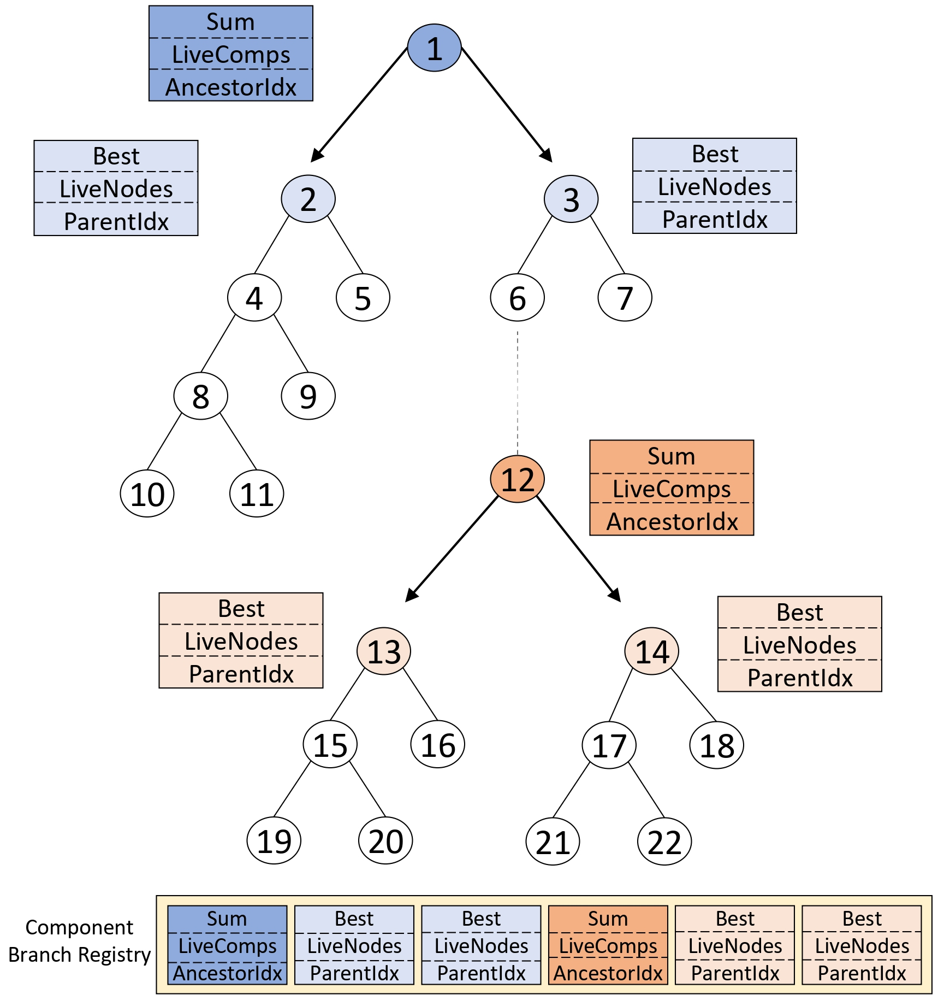

# Faster Vertex Cover Algorithms on GPU
Faster vertex cover algorithms on GPUs with component-aware parallel branching by Hussein Amro, Basel Fakhri, Amer E. Mouawad, and Izzat El Hajj.
<p align="center">  </p>

# Reference
- H. Amro, B. Fakhri, A. E. Mouawad and I. E. Hajj, "Faster Vertex Cover Algorithms on GPUs With Component-Aware Parallel Branching," in IEEE Transactions on Parallel and Distributed Systems, vol. 37, no. 2, pp. 504-517, Feb. 2026, doi: [10.1109/TPDS.2025.3641049](https://doi.org/10.1109/TPDS.2025.3641049).

Please cite this paper if you find our work useful.

# Description
CUDA/C++ implementation of a component-aware, load-balanced GPU solver for Minimum Vertex Cover and its parameterized (k-VC) variant. It detects when a graph splits into components and branches on the components independently, parallelizes non-tail-recursive branches via last-descendant aggregation while maintaining load balance, and reduces the memory footprint by reducing the graph and inducing a subgraph before exploring the search tree—achieving seconds-scale runtimes where the prior GPU state-of-the-art exceeds 6 hours [1].

# Artifact Instructions (For Reproducibility)

All commands below should be executed from the `src/` directory unless stated otherwise.

## Folders

- data: Contains the graph datasets used for evaluation [2],[3].
- src: Contains the source code of the project.

## Experimental Setup

- We implement our code using C++ and CUDA, and compile it with nvcc from the CUDA SDK version 11.7. We evaluate our CPU implementation using an AMD EPYC 7551P CPU with 128GB of main memory. We evaluate our GPU implementations using a Volta V100 GPU with 32GB of device memory.
- The codebase is designed to be portable across NVIDIA GPUs, automatically adapting to the available hardware to maximize resource utilization and performance. For a GPU with a different compute capability, update the `-gencode arch=compute_XX,code=sm_XX` target in `src/Makefile`.

## Requirements

- NVIDIA GPU with CUDA support.
- CUDA Toolkit with `nvcc` available, CUDA 11.7 or newer is recommended.
- GCC/G++ version supported by the installed CUDA Toolkit.
- GNU Make. The repository build is provided through `src/Makefile`.
- Python 3.10 or newer.
- Python packages `pandas` and `matplotlib` are needed for plotting artifacts.

## Build

Compile the normal executable:

```bash
make clean
make
```

This produces:

```text
src/output
```

Run help to see all arguments:

```bash
./output -h
```

General run format for MVC, which is the default instance:

```bash
./output -f ../data/<graph>.txt -v <hybrid|stackonly|sequential>
```

General run format for PVC:

```bash
./output -f ../data/<graph>.txt -v <hybrid|stackonly|sequential> -i pvc -k <k>
```

Runtime details are saved in `src/Results/Results.csv`.

## Table I: MVC Execution Time

Table I contains the MVC runtimes for these implementations:

- `Sequential`: run this repository with `-v sequential`.
- `No load balance`: run this repository with `-v stackonly`.
- `Load balanced (proposed)`: run this repository with `-v hybrid`.

For each graph:

```bash
./output -f ../data/<graph>.txt -v sequential
./output -f ../data/<graph>.txt -v stackonly
./output -f ../data/<graph>.txt -v hybrid
```

Use the terminal `Elapsed time` line for each implementation. Convert GPU milliseconds to seconds.

```text
Elapsed time: <value>
```

Sequential runs print this value in seconds. GPU runs print this value in milliseconds, marked with `ms`; divide by `1000` to obtain the seconds reported in the table. The MVC solution size is printed on this terminal line:

```text
Size of minimum vertex cover: <value>
```

Example for the proposed implementation on `rajat28`:

```bash
./output -f ../data/rajat28.txt -v hybrid
```

## Table II: Incremental Impact of Each Optimization

Table II is generated by running the MVC solver while disabling one optimization at a time.

Proposed implementation:

```bash
./output -f ../data/<graph>.txt -v hybrid
```

Disable branching on components:

```bash
./output -f ../data/<graph>.txt -v hybrid -c 0
```

Disable reducing and inducing the graph:

```bash
./output -f ../data/<graph>.txt -v hybrid -r 0
```

Disable bounding non-zero entries:

```bash
./output -f ../data/<graph>.txt -v hybrid -z 0
```

Use the terminal `Elapsed time` line for each entry. Convert GPU milliseconds to seconds.

## Table III: Search Tree Nodes and Component Branching Statistics

For the `Branching on components disabled` column, compile with counters only:

```bash
make clean
make USE_COUNTERS=1
```

Then run:

```bash
./output -f ../data/<graph>.txt -v hybrid -c 0
```

This produces per-SM node counts in:

```text
src/NODES_PER_SM/NODES_PER_SM_<graph>.txt
```

After running all graphs whose tree-node counts should be included, enter the `NODES_PER_SM` directory and run the script:

```bash
cd NODES_PER_SM
python nodes_visited_script.py
cd ..
```

This generates:

```text
src/NODES_PER_SM/nodes_visited.csv
```

Some `Branching on components disabled` entries are reported with a `>` sign because the corresponding run did not finish within six hours. To reproduce the tree-node count for those timeout entries, compile with counters and the timeout flag:

```bash
make clean
make USE_COUNTERS=1 RUN_KILL_TIMEOUT=1
```

Then run the same command. The kernel stops after the timeout condition used for evaluation, and the generated `NODES_PER_SM_<graph>.txt` file contains the number of tree nodes visited before timeout. After all timeout runs are complete, run `nodes_visited_script.py` from inside `NODES_PER_SM` again to produce the corresponding `>` values for `nodes_visited.csv`.

For the `Branching on components enabled (Proposed)` columns, compile with both counters and component-branch tracking enabled:

```bash
make clean
make USE_COUNTERS=1 COUNT_BRANCHING_ON_COMPONENTS=1
```

Then run:

```bash
./output -f ../data/<graph>.txt -v hybrid
```

This produces per-SM node counts in:

```text
src/NODES_PER_SM/NODES_PER_SM_<graph>.txt
```

and component-branching statistics in:

```text
src/Num_Branches/Num_Branches_<graph>.txt
```

After running all graphs whose tree-node counts should be included, enter the `NODES_PER_SM` directory and run the script using the same commands shown above for `Branching on components disabled`.

This generates:

```text
src/NODES_PER_SM/nodes_visited.csv
```

Mapping to Table III:

- `Tree nodes visited`: from `nodes_visited.csv`.
- `Branches on components`: from the line `Branches on components:` in `Num_Branches_<graph>.txt`.
- `Components per branch`: from the dictionary printed in `Num_Branches_<graph>.txt`.

## Table IV: Impact of Reducing and Inducing a Subgraph

Table IV is read from terminal output.

For all `Before` columns, run without reducing and inducing:

```bash
./output -f ../data/<graph>.txt -v hybrid -r 0
```

Use these terminal lines from that run:

```text
Original graph size = <value>
NumOfBlocks : <value>
Use Shared Mem : <0 or 1>
```

For all `After` columns, run with reducing and inducing enabled, which is the default:

```bash
./output -f ../data/<graph>.txt -v hybrid
```

Use these terminal lines from that run:

```text
Induced graph size = <value>
NumOfBlocks : <value>
Use Shared Mem : <0 or 1>
DataType <'int' or 'short'> was used for vertexDegrees
```

Mapping to Table IV:

- `Number of vertices in the degree array, Before`: `Original graph size` from the `-r 0` run.
- `Number of vertices in the degree array, After`: `Induced graph size` from the default run.
- `Number of thread blocks launched, Before`: `NumOfBlocks` from the `-r 0` run.
- `Number of thread blocks launched, After`: `NumOfBlocks` from the default run.
- `Degree array fits in shared memory, Before`: `Use Shared Mem : 1` from the `-r 0` run means `Yes`; `0` means `No`.
- `Degree array fits in shared memory, After`: `Use Shared Mem : 1` from the default run means `Yes`; `0` means `No`.
- `Short data type for degree array, Before`: `No`, because using `short` for the degree array is part of the reducing and inducing optimization; when that optimization is disabled, `int` is used.
- `Short data type for degree array, After`: `DataType 'short'...` means `Yes`; `DataType 'int'...` means `No`.

## Figure 4: Execution Time Breakdown

Compile with counters enabled:

```bash
make clean
make USE_COUNTERS=1
```

Run the proposed MVC implementation on each graph:

```bash
./output -f ../data/<graph>.txt -v hybrid
```

Each run writes a counter file:

```text
src/Counters/Counters_<graph>.txt
```

After finishing the runs for all graphs that should appear in the plot, enter the `Counters` directory and generate the plot:

```bash
cd Counters
python generate_breakdown.py
cd ..
```

The plot is saved as:

```text
src/Counters/breakdown.jpg
```

## Table V: PVC Execution Time

Table V uses the parameterized vertex cover mode.

For each graph, run three values of `k`:

```text
k = min - 1
k = min
k = min + 1
```

where `min` is the MVC value reported in `src/MVCs.txt`, obtained from the MVC runs used for Table I.

Run PVC as:

```bash
./output -f ../data/<graph>.txt -v sequential -i pvc -k <k>
./output -f ../data/<graph>.txt -v stackonly  -i pvc -k <k>
./output -f ../data/<graph>.txt -v hybrid     -i pvc -k <k>
```

Use the terminal `Elapsed time` line for each entry. Convert GPU milliseconds to seconds.

PVC runs also print one of the following terminal lines, indicating whether the minimum vertex cover size is at most `k`:

```text
Minimum is less than or equal to K: <k>
Minimum is greater than K: <k>
```

## Table VI: MVC Execution Time on Additional Graphs

For each Table VI graph file in `data/`, run:

```bash
./output -f ../data/<graph>.txt -v hybrid
```

Use the terminal `Elapsed time` line, converted to seconds, as the proposed runtime.

## Artifact Output Directories

The artifact creates these directories/files as needed:

```text
src/Counters/Counters_<graph>.txt
src/Counters/breakdown.jpg
src/NODES_PER_SM/NODES_PER_SM_<graph>.txt
src/NODES_PER_SM/nodes_visited.csv
src/Num_Branches/Num_Branches_<graph>.txt
```

## Artifact Notes

Reported values may differ slightly from run to run for all tables except Table IV.

Instrumentation builds that enable `USE_COUNTERS`, `COUNT_BRANCHING_ON_COMPONENTS`, or `RUN_KILL_TIMEOUT` are intended for artifact generation and profiling. They add overhead and should not be used for the main timing numbers in Tables I, II, V, and VI.

The baseline Yamout et al. [1] results reported in Tables I and V can be obtained by running the same graph instances on their public implementation [4]. For Table VI, the baseline Yamout et al. [1] results are taken from the corresponding table in their paper.

# Implementation Overview

1- Component-aware branching that detects connected components on the fly and solves them independently to avoid redundant work, managed by the Component Branch Registry `compArray`. <br>
2- Preprocessing on the CPU, including crown reduction, to form an induced subgraph that the GPU can process with lower memory and higher parallelism. <br>
3- Occupancy-aware launch that considers input size and device limits to maximize GPU utilization and select an optimal configuration. <br>
4- Placing the per-node degree array in shared memory when it fits at runtime and falling back to global memory otherwise, to reduce access latency. <br>
5- Selecting `int16_t` over `int32_t` for the degree array entries when the runtime max degree permits, shrinking memory per block, and enabling more concurrent workers. <br>
6- Load balancing via a global worklist `GlobalWorkList` to keep all blocks busy. <br>

# Code Structure

**Core Modules**
- **main.cu** Orchestrates execution: parses config for CSR graph construction, applies heuristics & reductions, then selects the sequential or GPU path and launches the appropriate kernels.
- **GlobalWorkList.cuh**
  Implements the global-worklist exact MVC kernels, providing dynamic load balancing across blocks/SMs during branching.
- **GlobalWorkListParameterized.cuh**
  Implements the global-worklist kernels for the parameterized `k`-Vertex Cover (PVC), with dynamic load balancing and `k`-aware pruning.
- **LocalStacks.cuh**
  Implements the stack-only exact MVC kernels, per-block local stacks with no global worklist and no dynamic load balancing.
- **LocalStacksParameterized.cuh**
  Implements stack-only kernels for parameterized `k`-Vertex Cover, using per-block local stacks and `k`-aware pruning with no global worklist and no dynamic load balancing.
- **Sequential.cpp**
  Implements the CPU baseline: a sequential exact Minimum Vertex Cover solver (branch-and-reduce/DFS) for comparison with GPU kernels.
- **SequentialParameterized.cpp**
  Implements the CPU baseline for parameterized `k`-Vertex Cover using branch-and-reduce with `k`-aware pruning.

**Data Structures**
- **CSRGraphRep.cuh** Defines the CSR graph structure and device functions to allocate, copy, and free GPU-side arrays (`dst`, `srcPtr`, `degree`).
- **BWDWorkList.cuh**
Implements a ticketed ring-buffer global worklist for dynamic inter-block load balancing, atomic head/tail, per-slot `tickets`, combined counters (`numWaiting`/`numEnqueued`), exponential backoff (`__nanosleep`), thresholds, and PVC/connected-components enqueue/dequeue variants, adapted from [5].
- **stack.cuh**
Defines per-block GPU stacks with device `push`/`pop` (and connected-components variant) plus alloc/free, storing vertex-degree snapshots, deleted-counts, array indices, and flags.
- **compArray.cuh**
Implements Component Branch Registry for Component-Aware Parallel Branching.

**Reduction Algorithms**
- **helperFunctions.cpp** Implements sequential reduction rules (`leaf`, `highDegree`, `triangle`, `clique`, `cycle`), `deleteVertex`, and utilities used by the CPU MVC solver.
- **helperFunctions.cuh**
Implements device functions reduction rules, max-degree branching, and component discovery (`BFS`/`SCC`) for stack-only and globalWorkList GPU kernels.
- **crown.cpp**
Implements the root-node crown reduction to shrink the graph before launching the sequential solvers or GPU kernels.
- **hopcroft_karp.cpp**
Implements the Hopcroft-Karp algorithm for maximum bipartite matching, powering the crown reduction's matching step.

**Utilities**
- **Counters.cuh** Per-block profiling: enum-based per-block counters using `clock64` to time each algorithm step, max-depth tracking, and host-side CSV dumps plus per-SM node counts.
- **auxFunctions.cpp**
Pre-kernel setup: builds the CSR graph, approximates MVC heuristics, then selects blocks/threads and shared vs global memory via `setBlockDimAndUseGlobalMemory`.
- **config.h**
Defines runtime configuration, default argument values, and command-line parsing.
- **Makefile**
Builds the executable and exposes artifact-related compile-time flags such as `USE_COUNTERS`, `COUNT_BRANCHING_ON_COMPONENTS`, and `RUN_KILL_TIMEOUT`.

# References

<a id="1">[1]</a> P. Yamout, K. Barada, A. Jaljuli, A. Mouawad, I. El Hajj. Parallel Vertex Cover Algorithms on GPUs. In Proceedings of the IEEE International Parallel & Distributed Processing Symposium (IPDPS), 2022. [LINK](https://arxiv.org/pdf/2204.10402)

<a id="2">[2]</a> R. A. Rossi and N. K. Ahmed, "The network data repository with interactive graph analytics and visualization," in AAAI, 2015. [Online]. Available: https://networkrepository.com

<a id="3">[3]</a> M. A. Dzulfikar et al., "The pace 2019 parameterized algorithms and computational experiments challenge: the fourth iteration," in 14th International Symposium on Parameterized and Exact Computation (IPEC 2019). Schloss Dagstuhl-Leibniz-Zentrum fuer Informatik, 2019.

<a id="4">[4]</a> pky00/Parallel-Vertex-Cover-Algorithms-on-GPUs. [GitHub](https://github.com/pky00/Parallel-Vertex-Cover-Algorithms-on-GPUs)

<a id="5">[5]</a> B. Kerbl et al., "The broker queue: A fast, linearizable FIFO queue for fine-granular work distribution on the GPU," in Proceedings of the 2018 International Conference on Supercomputing, 2018, pp. 76-85. [LINK](https://arbook.icg.tugraz.at/schmalstieg/Schmalstieg_353.pdf)
