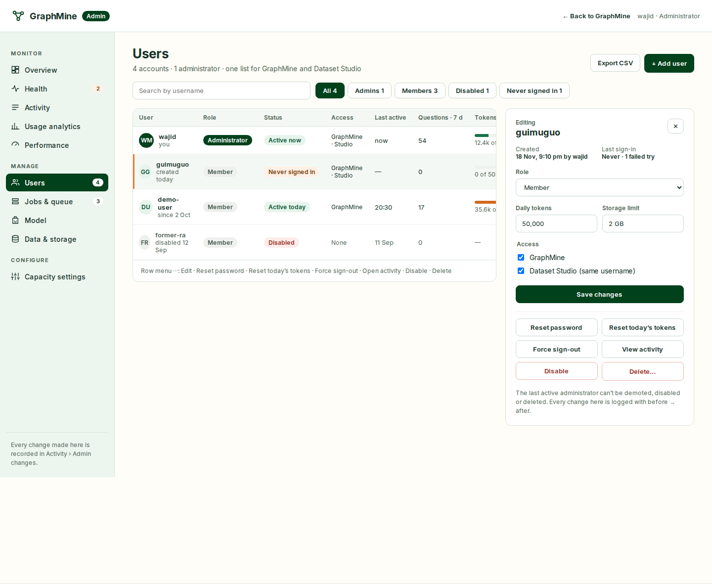
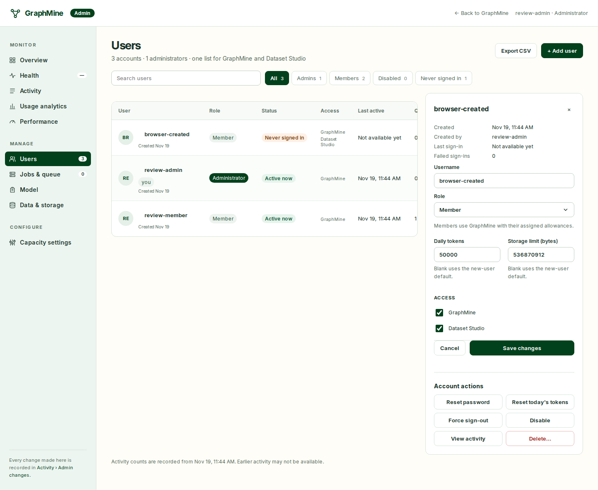
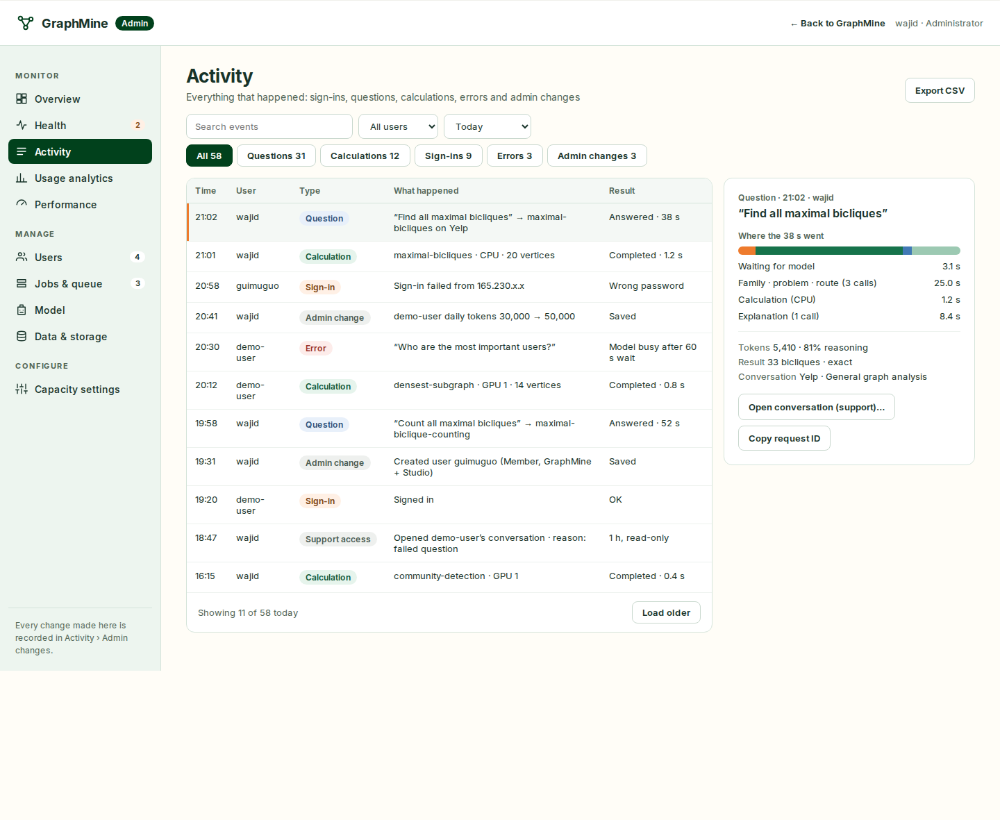
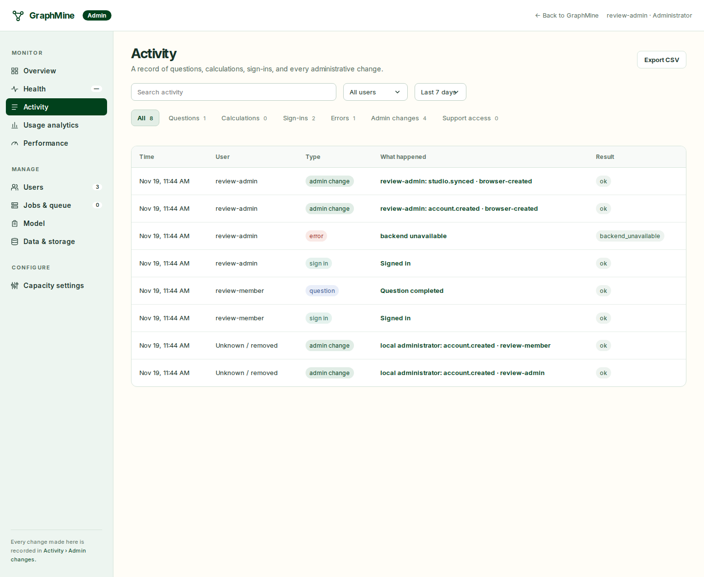
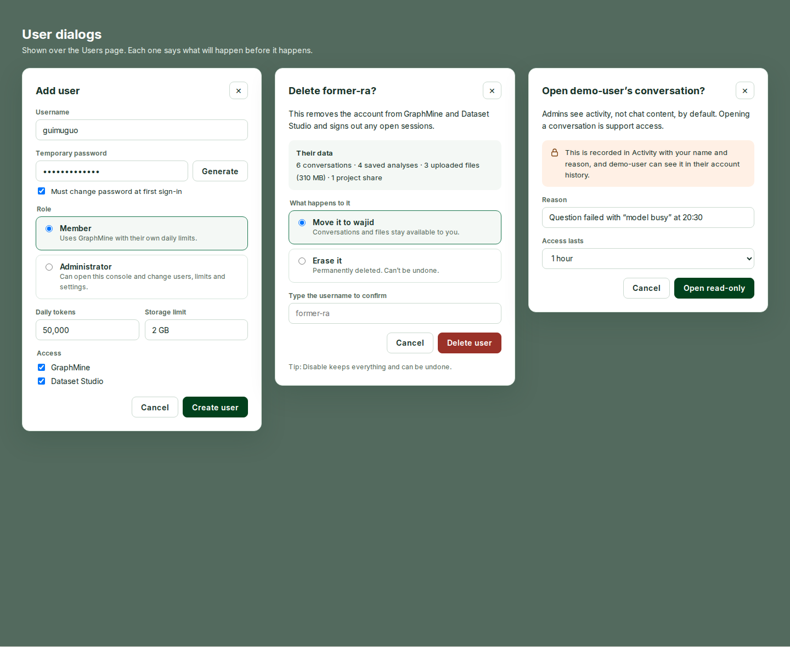
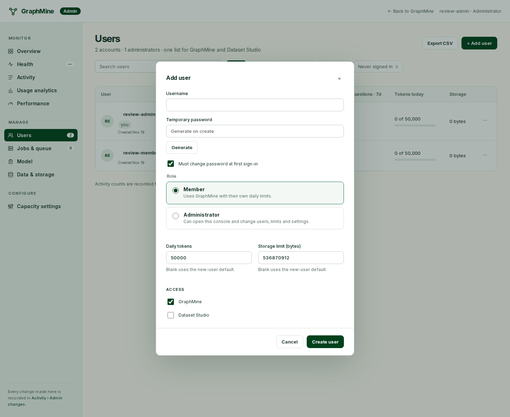

# Admin console — phase 1 evidence

Screenshots are produced by `agent/tests/test_admin_browser.py` against a disposable
local server. The account names and conversation shown are test fixtures; every
number in the screenshots is returned by that server. No production credentials or
conversation content are included.

The reference artboards were exported from the supplied `GraphMine Admin Console.html`.
The implemented shell, compact controls, inline edit/detail panels and Add user role
choices follow that reference. Live counts, long account names, and unavailable
measurements naturally differ from the design examples. Question content remains
behind support access, as required by the security brief.

| Design artboard | Implementation |
| --- | --- |
|  |  |
|  |  |
|  |  |

| Page or dialog | Screenshot |
| --- | --- |
| Users and shared shell | [Users](01-users.png) |
| Add user | [Add user](02-add-user.png) |
| Edit user | [Edit user](03-edit-user.png) |
| Delete user | [Delete user](04-delete-user.png) |
| Activity | [Activity](05-activity.png) |
| Before/after change details | [Admin change](06-admin-change.png) |
| Question metadata | [Question details](07-question-details.png) |
| Support access | [Grant dialog](08-support-access.png) |
| Read-only conversation | [Support view](09-support-read-only.png) |
| Narrow-screen shell | [Mobile Users](10-users-mobile.png) |
| Member and signed-out denial | [Access required](11-access-required.png) |

To reproduce, install the agent's test dependencies and Playwright Chromium, then:

```sh
PYTHONPATH=agent GRAPHMINE_ADMIN_SCREENSHOTS=validation/admin-console/phase-1 \
  python -m pytest agent/tests/test_admin_browser.py
```

The test creates its own accounts, SQLite store, Studio account file, and localhost
server. It does not access production accounts or invoke the model.
