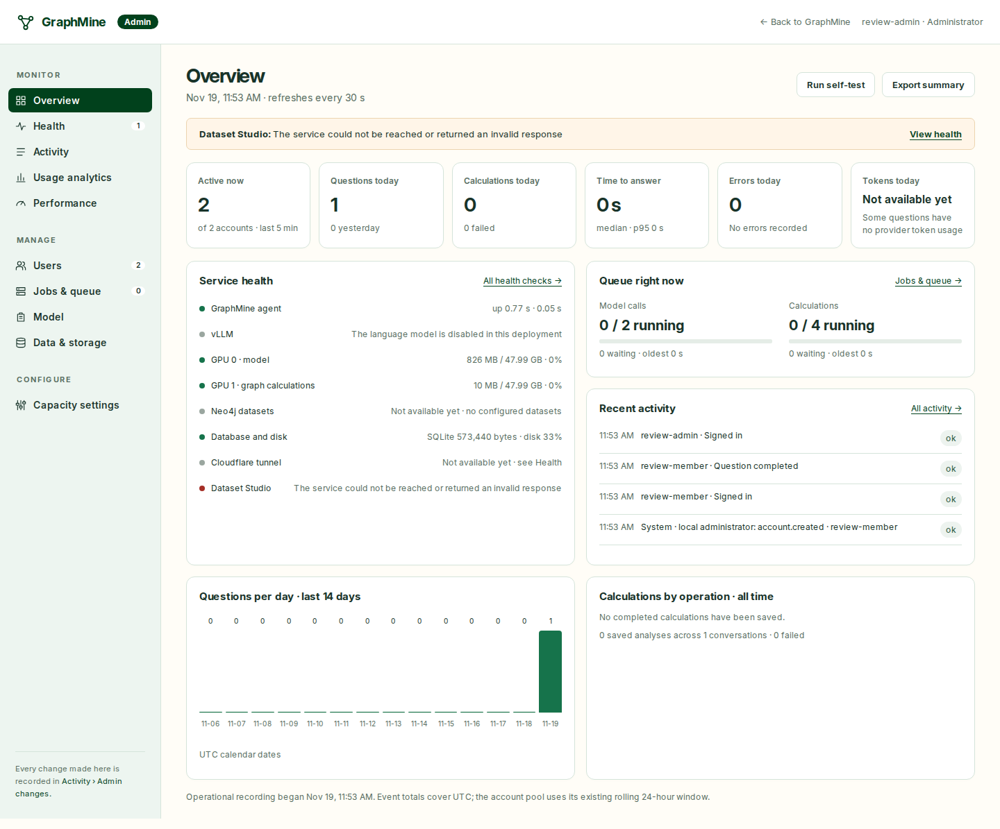
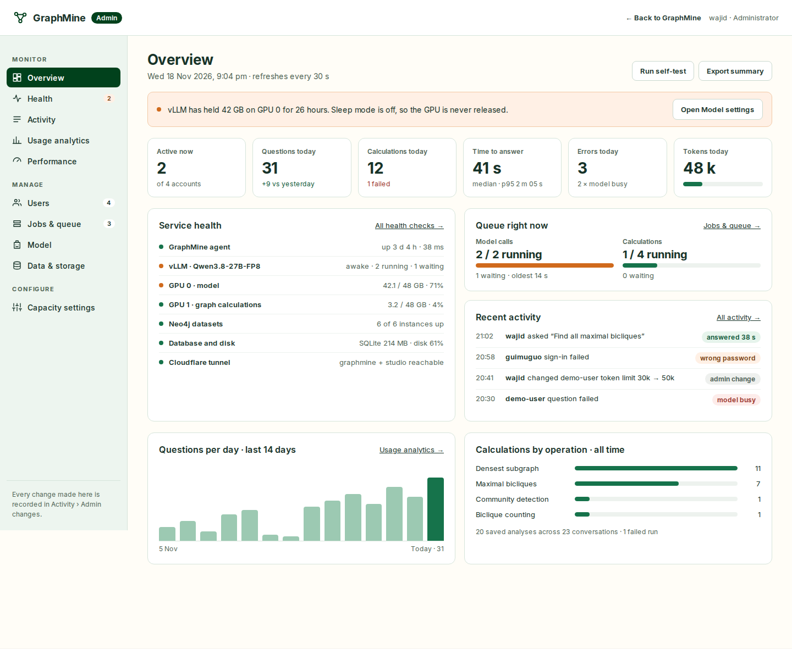
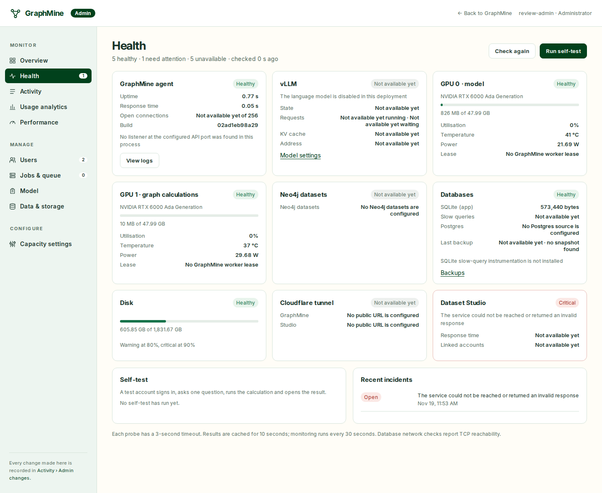
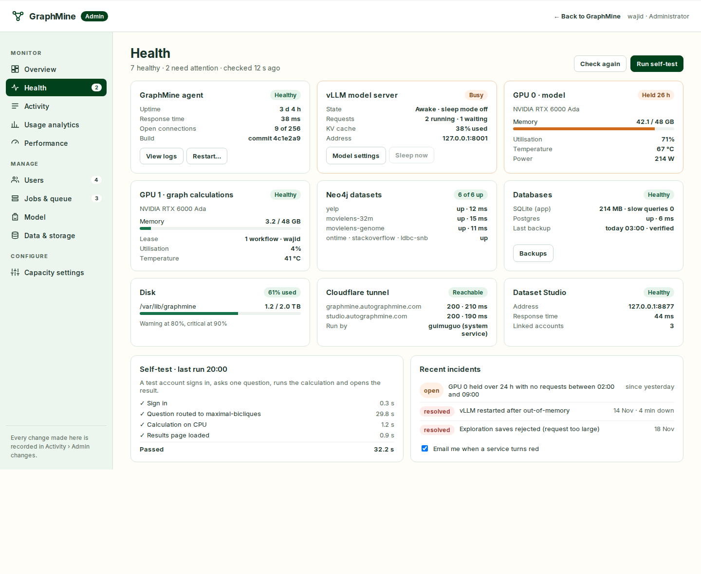
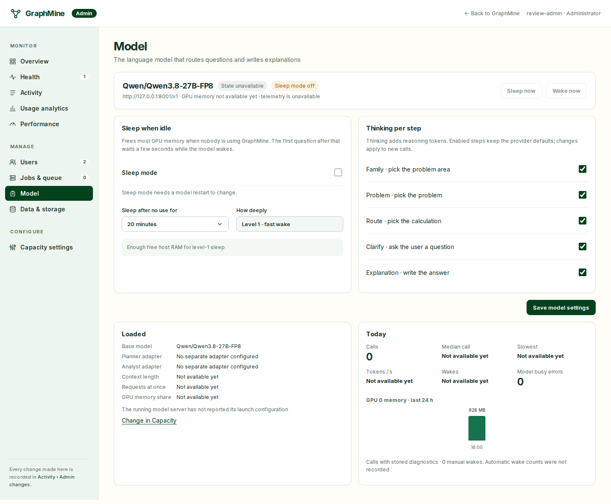
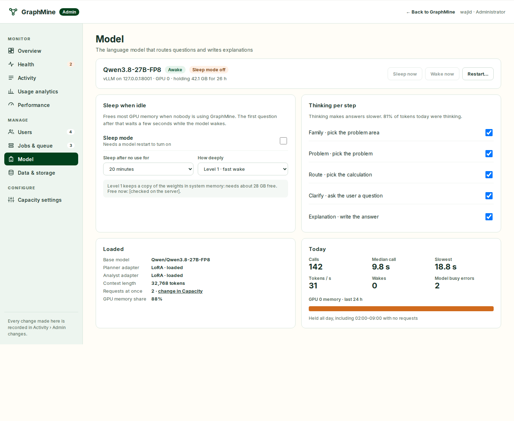

# Admin console · phase 2 evidence

Chromium screenshots use a disposable account database. Account/event counts come
from API writes, hardware figures come from server probes, and unconfigured
services show their availability reason. No example production numbers are seeded.

| Page | Implementation | Supplied artboard |
| --- | --- | --- |
| Overview |  |  |
| Health |  |  |
| Model |  |  |

Also captured: [mobile Overview](overview-mobile.png) and [self-test dialog](selftest-dialog.png).
The reference images were exported from the supplied local HTML; see [source details](../reference/README.md).
Layouts follow the artboards. Runtime configuration and unavailable telemetry affect content and card height.

`test_admin_monitor_browser.py` opens every phase-2 page, saves idle/thinking
settings through the API, checks the values after reload, and finds the corresponding
admin-change event. The API suite covers probe timeouts and cache reuse, incident
opening/recovery, range/type validation, restart confirmation, queue measurements,
and external rejection of self-test credentials and tokens. The self-test acceptance
uses real sign-in, graph upload, native CPU execution, and result retrieval, with an
authored question-provider response; it is not a claim of live LLM accuracy.

Production services and real user accounts are not changed by these tests.
