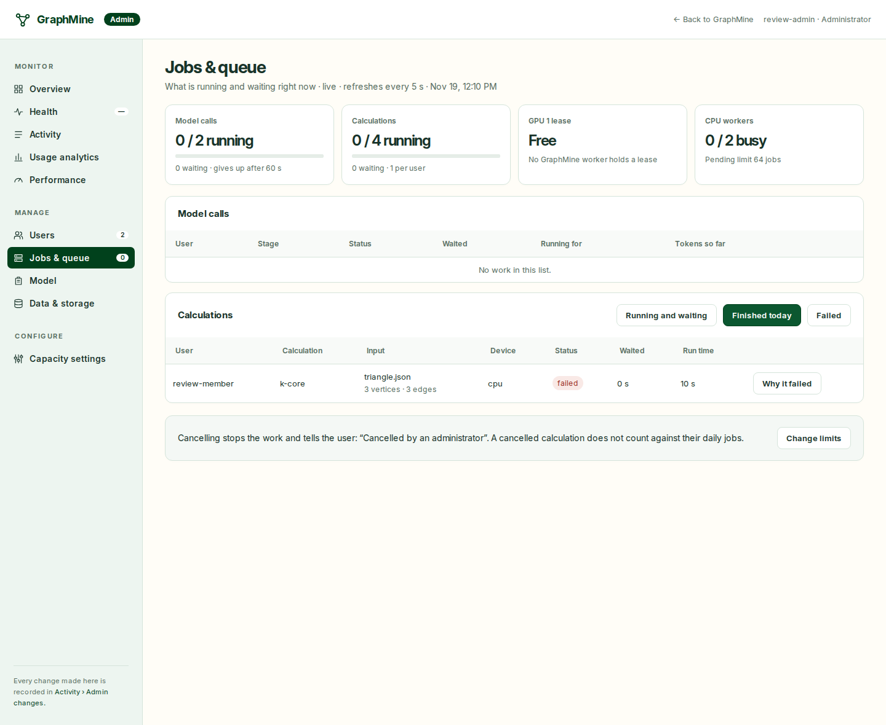
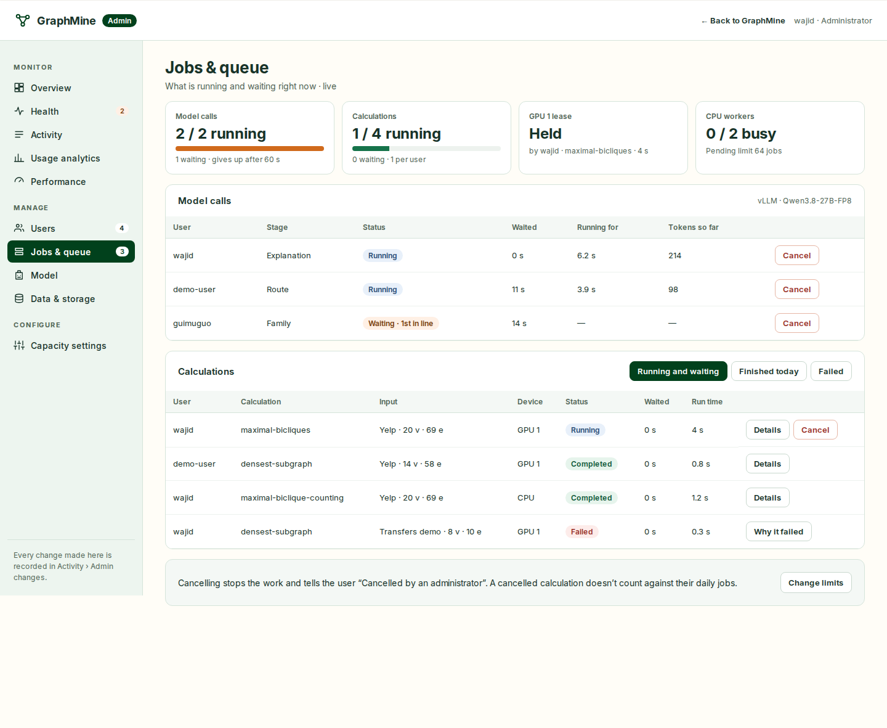
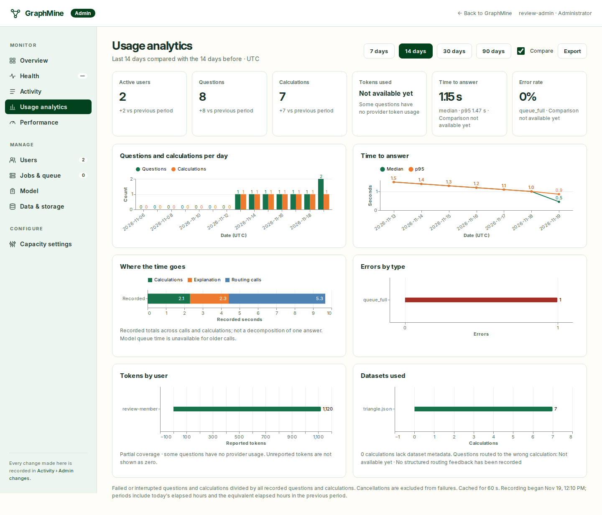
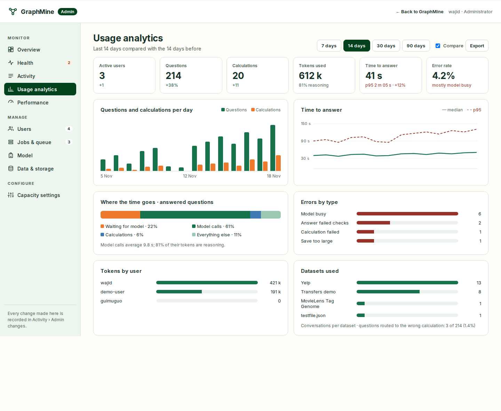

# Admin console · phase 3 evidence

Chromium uses a disposable account database, operational event fixtures and one
archived failed calculation. Page values are fetched from the API, with missing
provider usage explicitly labelled. The images do not represent production load.

| Page | Implementation | Supplied artboard |
| --- | --- | --- |
| Jobs & queue |  |  |
| Usage analytics |  |  |

Also captured: [calculation details](calculation-details.png) and
[mobile Usage](usage-mobile.png). Reference images come from the supplied local
HTML; see [source details](../reference/README.md).

The browser test checks filters, failure details without chat content, all six
local Vega-Lite charts under the unchanged strict CSP, period comparison, CSV
export and mobile overflow. Backend acceptance cancels queued and running
workflows, checks the owner event, refunds once (including shared batch quotas),
checks model-call queue positions and cancellation, and verifies UTC aggregates,
percentiles, partial token coverage, cache expiry and exports. Existing admin
security tests discover and deny every new route for members and signed-out users.

Production services and real user accounts are unchanged by these tests.
