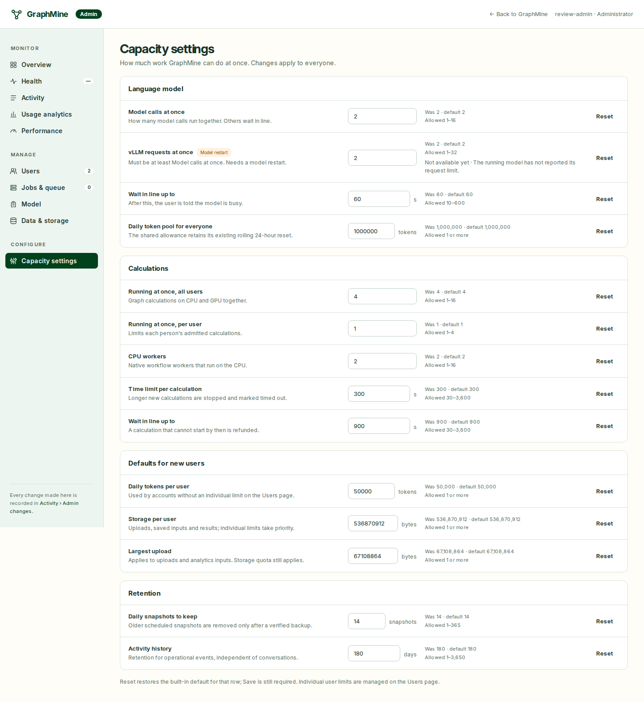
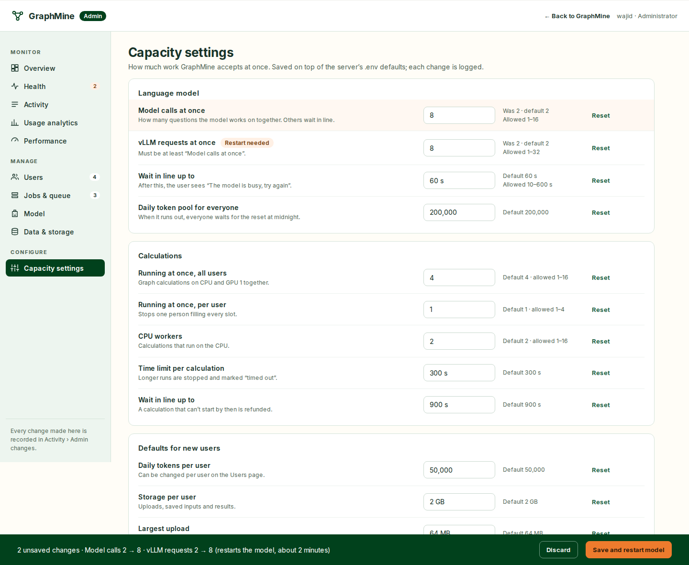
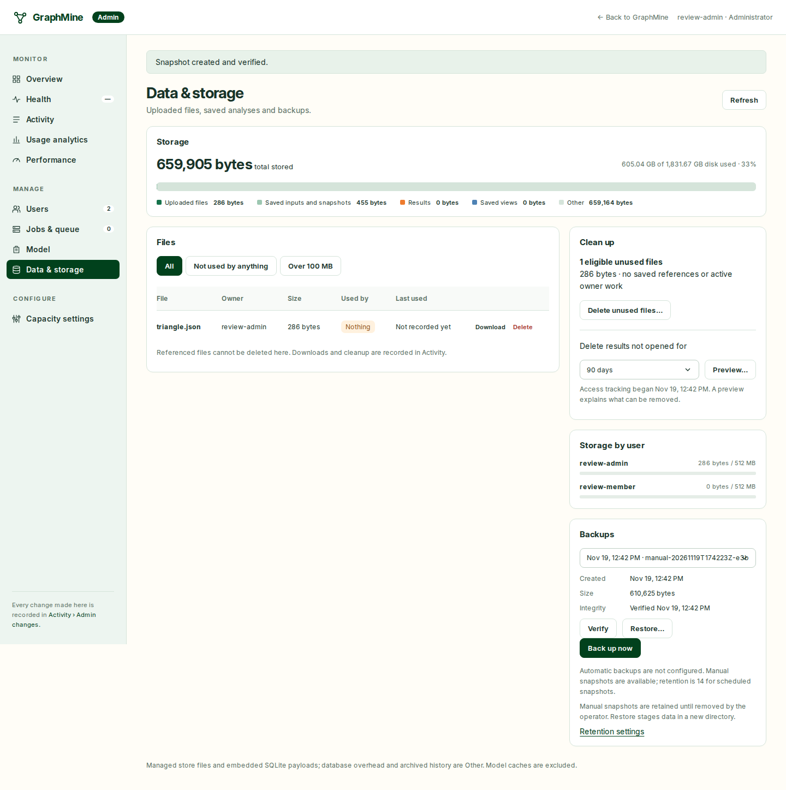
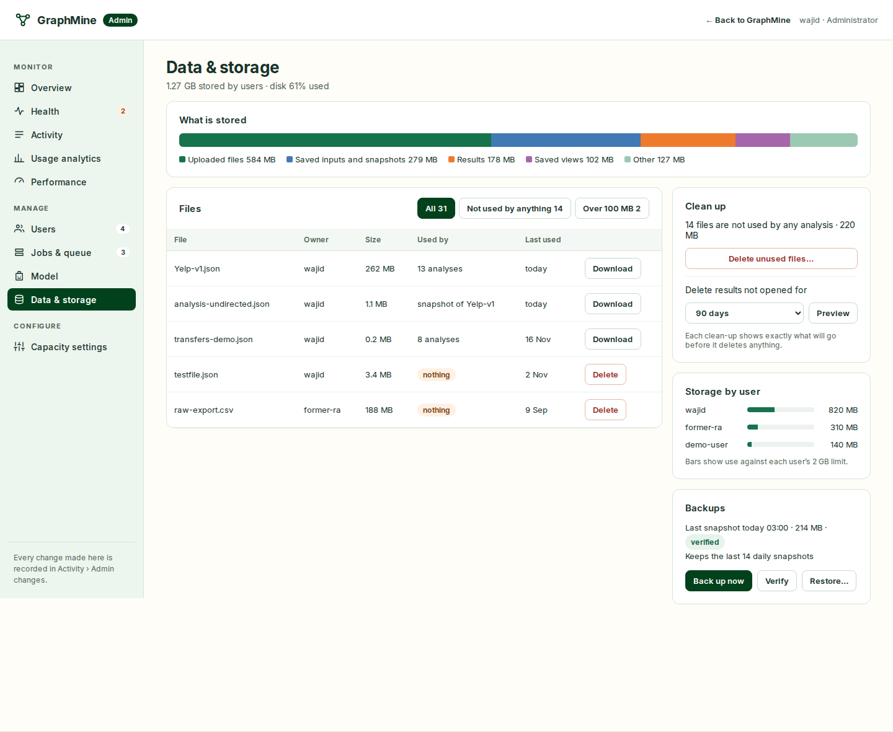
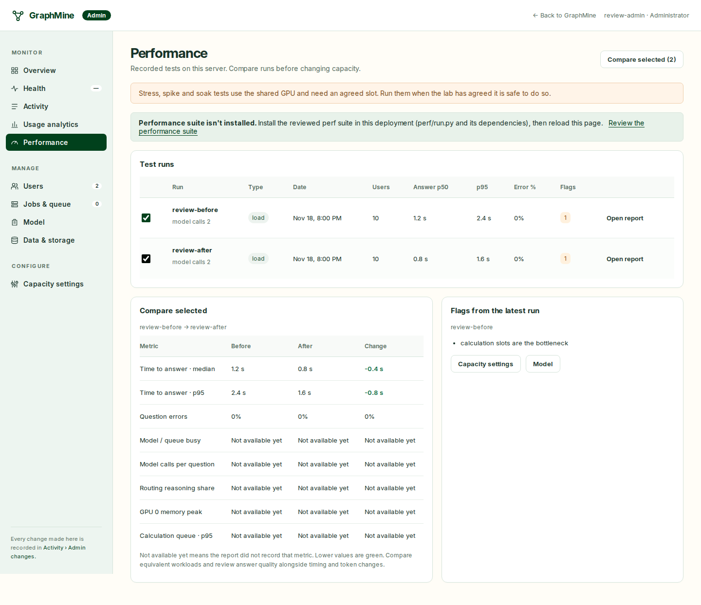
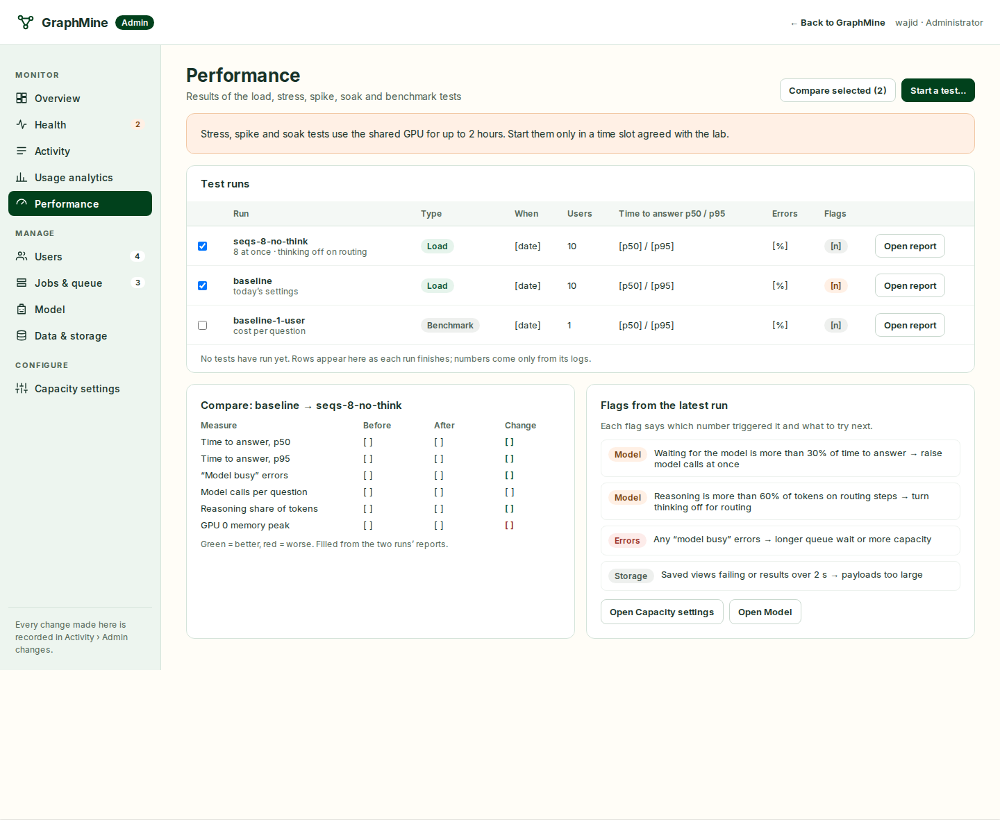

# Admin console · phase 4 evidence

Chromium uses disposable accounts, a real uploaded triangle graph, a verified
snapshot of that store and deterministic performance-report fixtures. Every page
fetches its numbers from the server. These are acceptance fixtures, not production
load measurements; missing metrics remain explicitly unavailable.

| Page | Implementation | Supplied artboard |
| --- | --- | --- |
| Capacity settings |  |  |
| Data & storage |  |  |
| Performance |  |  |

Also captured: [unsaved capacity changes](capacity-unsaved.png),
[cleanup confirmation](cleanup-preview.png), [mobile Capacity](capacity-mobile.png),
[mobile Data](data-mobile.png), and [mobile Performance](performance-mobile.png).
References come from `GraphMine Admin Console.html`; see
[source details](../reference/README.md).

The browser test saves a capacity change and checks its audit entry, creates and
verifies a backup, downloads an upload, previews and confirms cleanup, compares
two saved performance reports, checks the missing-suite state and verifies mobile
overflow. Backend acceptance covers range/type validation, conflicting saves,
live consumers, actual per-user admission, pending model limits, changed file
references, active owner work, external paths, historical/recent/protected results,
legacy result cleanup, backup tampering, staged restore, private report metadata,
the report sandbox and safe background-test invocation. The subprocess fixture
does no GPU work. Existing security tests discover every admin route and verify
403 for members and signed-out requests.

Production services and real user accounts are unchanged by these tests.
